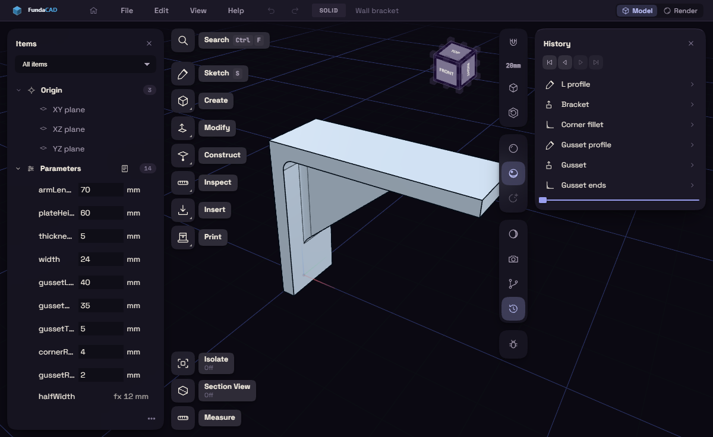
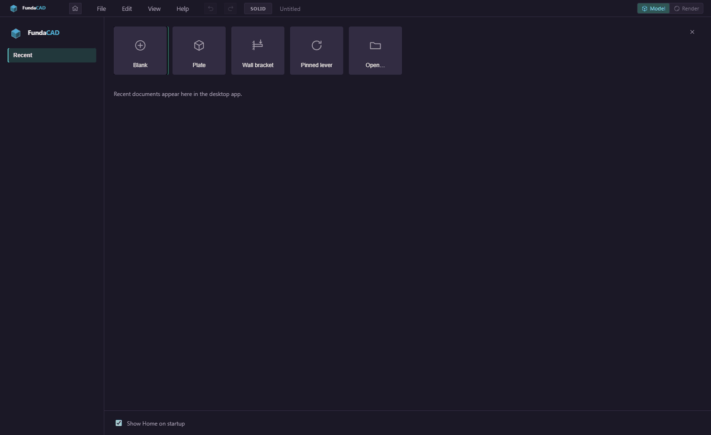
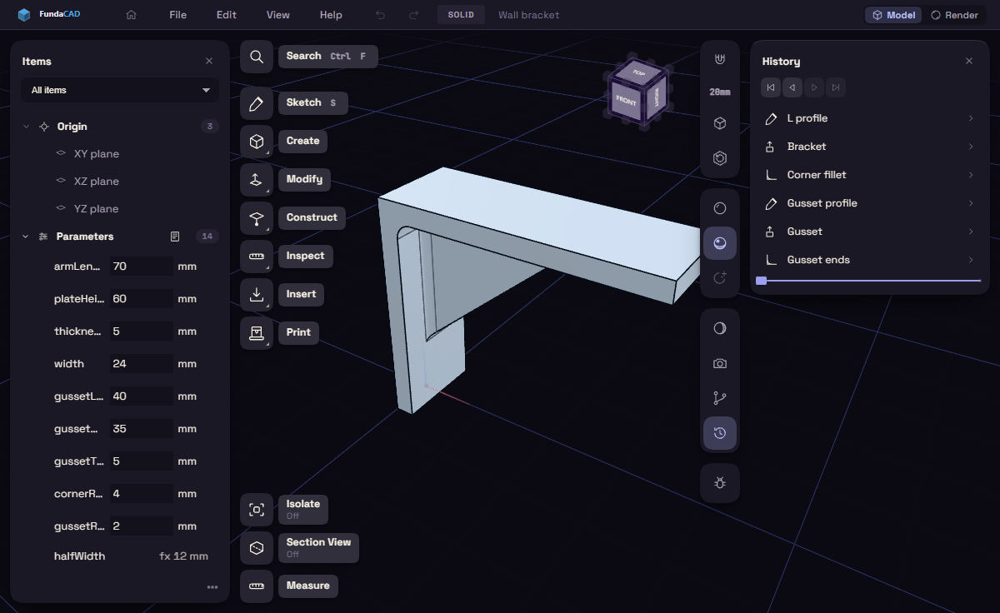
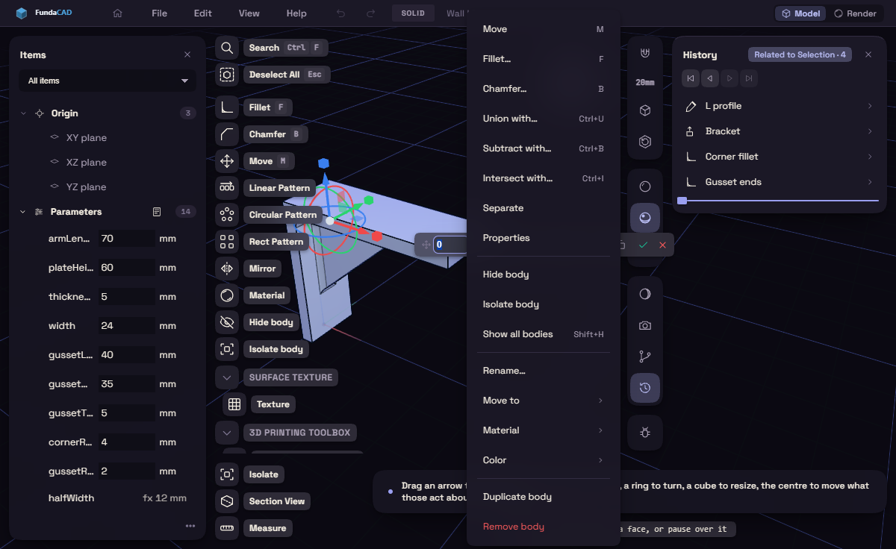
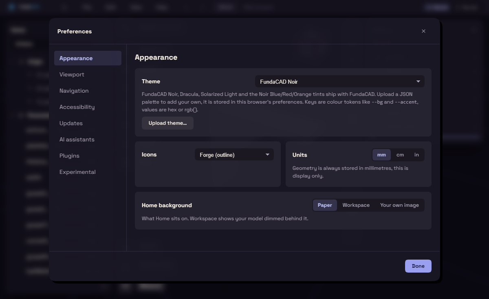
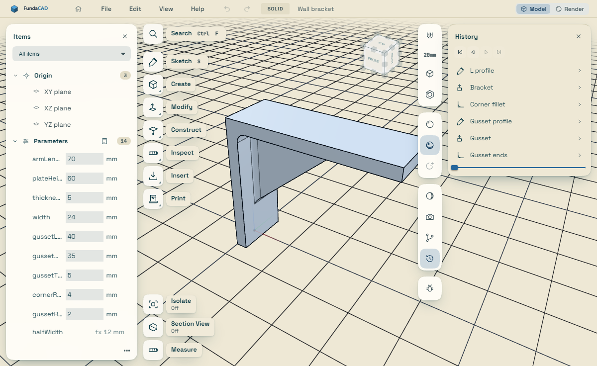

# FundaCAD design spec

This is the visual language of FundaCAD as it exists in the code, written for
whoever is about to build or change UI: a contributor, a plugin author or an AI
agent. Read it before you write markup or styles, and run the
[checklist](#13-checklist-before-ui-work-is-done) before you call the work done.

The code is the source of truth. Every value below is quoted from
`src/styles/_tokens.scss`, `src/styles/_glass.scss` and the other partials in
`src/styles/`. Where this page asks for something no code does yet, it says
so with the words **prescribed, no code does this yet**. If you change one of
those files, change this page in the same commit.
`tests/ui/designSpec.test.ts` holds the rules a machine can check
([section 15](#15-the-guard-test)).



## 1. Principles

1. **The model is the hero.** The WebGL viewport fills the stage. Apart from
   the 36px title bar and, in Render mode, the Render dock column beside the
   stage, every piece of chrome floats over the model and leaves it visible
   around and through itself.
2. **Glass, never a slab.** A surface over the model is translucent: a tinted
   fill with `backdrop-filter: blur(24px) saturate(1.7)`, a faint top sheen, a
   1px light edge with an inner top highlight, a soft two layer shadow and
   squircle corners. Panels, cards, tiles, menus and dialogs also carry a lit
   rim that catches the accent at its far corner; pills and chips on the model
   (`.rail-pill`, the prompt, `.dim-field`, `.dim-btn`, `.areachip`) and the
   rail flyout do not. The bodies behind smear into the panel. That smear is
   the product's signature.
3. **Float with air.** Floating cards sit `--float-gap` (12px) from the stage
   edges and from each other. The layers that hold them pass pointer events
   through, so the model stays pickable in every gap.
4. **Calm surfaces.** All glass shares one shadow. Depth between surfaces comes
   from the fill strength (72% or 92%), the rim and stacking, not from bigger
   shadows. The accent appears only on what is active, selected, focused or
   primary, as a tint, a lit rim or a neon core, never as a large flat fill.
   One exception is in every tool panel: `.measure-title` is `--accent-hot`,
   so the readout reads as the tool's output ([7.13](#713-tool-and-readout-panels-measure-panel)).
   Card and dialog titles stay `--text`.
5. **Dense rows, generous shell.** Rows and labels are small (12 to 12.5px,
   34px rows, 40px tiles). The air lives at the shell level: gaps, card
   padding, big corner radii.
6. **Tokens only.** Every colour, radius, gap, duration and shadow is a custom
   property. Themes swap the colour tokens, and one shipped theme is light.
7. **Degrade, never redesign.** Blur off (potato mode or a software renderer),
   animations off and touch input each have one shared switch. A new surface
   that uses the shared tokens and classes supports all three with no code of
   its own.
8. **Reuse before you invent.** A new surface is an existing glass class, or a
   selector added to the existing lists in `_glass.scss`. A new look is almost
   always a mistake.

Nothing is flat and opaque unless this spec names it. The legitimate exceptions:

| Flat on purpose | Why |
|---|---|
| `#titlebar` (opaque `--panel`, `border-bottom: 1px solid var(--line)`) and what sits in it (`.tb-btn`, `.menu-btn`, `.seg-btn`, `#context-tab`) | The one full width strip that does not float; the stage starts below it |
| Inset wells inside a glass dialog (`.pref-card`, `.prefs-pane-flow .prefs-row`, `.plug-consent`, `.mats-list`) | Groups inside the glass shell; they never blur |
| Tiny labels on the model (`.snap-tag`, `.areabox`, `.sketch-dim`, viewport readouts) | Labels, not panels |
| Everything under `html.no-glass-blur` | A performance fallback, not a design ([4.5](#45-blur-off-and-potato-mode)) |

One surface is glass but docked, not floating: `#renderdock`, the Render
mode settings. `#main` is `grid-template-columns: minmax(0, 1fr) auto`
(`_layout.scss`), so the dock is a grid column that narrows the stage. It keeps
a `var(--s-3)` margin on the top, right and bottom and none against the stage,
blurs the page behind it rather than the model, and under 560px stacks below
the stage. It is the only docked panel. Do not dock a new one: a new panel
floats in `#float-layer` or wears `.measure-panel`.

### The failure this spec exists to prevent



The first Home screen covered the stage with opaque `var(--panel)`, used
`var(--raised)` tiles with `1px solid var(--line)` and `--r-md` corners, a
one off `box-shadow: -8px 0 24px rgba(0, 0, 0, 0.3)`, no blur, no rim, no
squircle and hex fallbacks from an old palette. It followed the flat base rules
of its sibling partials, which are not what the user sees: `_glass.scss`
repaints a fixed list of selectors, and Home was not on it. **If your screen
would not look like the same product as the workspace shot above, it is
wrong.**

## 2. Tokens

All tokens live on `:root` in `src/styles/_tokens.scss`. There are no SCSS
variables for design values, and `src/styles/main.scss` explains why.

Rules:

- Write `var(--token)` with **no fallback**. Fallbacks still sit in
  `_modals.scss` (`var(--accent, #ff7a3c)` and `var(--accent-hot, #ff9a5c)`,
  from an old orange palette), `_home.scss`, `_browser.scss`, `_layout.scss`,
  `_targetedit.scss` and several overlay components (`LiveSessionPill.vue`,
  `PropertiesPanel.vue`, `InterferencePanel.vue` and others). They never fire,
  and copying one spreads a value the theme cannot change.
- Never write a raw colour (`#hex`, `rgb()`, `hsl()`, a named colour) in a
  component or partial. Derive tints with `color-mix` on a token:
  `color-mix(in srgb, var(--accent) 16%, transparent)`. The one sanctioned set
  of literals is the white ink and the scrims of the glass, which belong in
  `_glass.scss` ([2.3](#23-the-white-ink-of-the-glass)).
- Never invent a token name. These are read in the code but defined nowhere and
  must not spread: `--danger` (use `--error`), `--fg` (`--text`), `--muted`
  (`--text-mute`), `--border` (`--line`), `--bg-panel` and `--panel-1`
  (`--panel`), `--panel-3` (`--panel-2`), `--fg-dim` (`--text-dim`),
  `--bg-sunken`. A new token goes in `_tokens.scss`, and a new colour token also
  in `PALETTE_TOKENS` in `src/ui/theme.ts`.

### 2.1 Colours by role (FundaCAD Noir values)

Surfaces, back to front:

| Token | Noir | Use |
|---|---|---|
| `--bg` | `#050409` | Page background, focus ring gap, panel field focus fill |
| `--viewport-bg` | `#0b0912` | The scene background, read by the Three side (`viewport/themeColors.ts`), not by CSS |
| `--panel` | `#1b1826` | Base of every glass fill (through `--float-bg`), the title bar, the no blur fill |
| `--panel-2` | `#272233` | Inset wells and flat inner controls, native `option` background |
| `--raised` | `#322c42` | Hover fill of flat rows and icon buttons |
| `--raised-2` | `#3d3651` | Off track of `.ft-switch`, hover of `.btn` before glass |

Borders:

| Token | Noir | Use |
|---|---|---|
| `--line` | `#322c42` | Hairline dividers between the parts of a dialog, menu or dock (`.modal-head`, `.modal-foot`, `.cmdk-input`, `.menu-sep`, `.ctx-sep`, `.rd-tabs`, `.prefs-nav`), wells and flat title bar controls |
| `--line-strong` | `#5c5470` | Flat control borders, the scrollbar thumb. Decorative only (2.45:1 on `--panel`) |
| `--float-line` | `rgba(255, 255, 255, 0.09)` | The 1px outer edge of every glass surface, and the dividers of cards and popovers (`.pop-rule`, `.float-card-foot`) |

Text:

| Token | Noir | Use |
|---|---|---|
| `--text` | `#f6f0e4` | Primary text, titles, values |
| `--text-dim` | `#aaa1b5` | Secondary labels, idle icons |
| `--text-mute` | `#7d7590` | Hints, caps labels, idle close glyphs, metadata. Fails AA on panels, never for text a user needs |

Accent (also what selected edges, dimensions and manipulator handles are drawn in):

| Token | Noir | Use |
|---|---|---|
| `--accent` | `#4bf9bc` | Primary button fill, focus borders, the tab underline and `.rd-tab` bar, switch on |
| `--accent-hot` | `#7dffd4` | Text and icons of an active, selected or hovered row; primary hover |
| `--accent-tint` | `rgba(75, 249, 188, 0.14)` | Light selected fill (`button.active`, `.prefs-nav-btn.active`, panel field ring) |
| `--accent-tint-2` | `rgba(75, 249, 188, 0.24)` | Stronger selected fill (`.seg-btn.active`, `.rd-chip.active`, `.pref-seg .on`) |
| `--accent-glow` | `rgba(75, 249, 188, 0.35)` | Halos: the focus ring, a lit tile, the primary button glow, the tab underline |
| `--on-accent` | `#00140d` | Text on an accent fill |
| `--accent-blue` | `var(--accent)` | Legacy alias kept for old plugins and palettes (`theme.ts` writes it with the accent). Never read it in new code |

Status:

| Token | Noir | Use |
|---|---|---|
| `--ok` | `#17c99a` | A step deeper than the accent, so an ok mark and a selection differ |
| `--warn` | `#ffab2e` | Warnings, amber History steps, `.perf-warn` |
| `--error` | `#ff5c5c` | Errors, destructive items, failed steps |
| `--error-tint` | `rgba(255, 92, 92, 0.14)` | Error backgrounds and the error focus ring |

There is no info, success tint, warn tint, disabled or hover token. Derive them:

| Need | Write |
|---|---|
| Menu or list row hover | `color-mix(in srgb, var(--accent) 16%, transparent)` |
| Selected row | `linear-gradient(90deg, color-mix(in srgb, var(--accent) 22%, transparent), color-mix(in srgb, var(--accent) 6%, transparent))` plus `box-shadow: inset 0 0 0 1px color-mix(in srgb, var(--accent) 26%, transparent)` |
| Accent border on hover | `color-mix(in srgb, var(--accent) 45%, transparent)` (buttons) or `55%` (cards, choice buttons) |
| Field focus ring | `0 0 0 3px color-mix(in srgb, var(--accent) 14%, transparent)` |
| Warn or error surface | `color-mix(in srgb, var(--warn) 9%, var(--float-bg-solid))` (`.perf-pop`), `color-mix(in srgb, var(--error) 22%, var(--float-bg-solid))` (`.toast-error`) |

### 2.2 Shape and motion tokens

These are never themed. They are covered in their own sections:
[glass](#4-the-glass-recipe), [type](#5-typography),
[spacing and radii](#6-spacing-radii-sizes-touch-and-breakpoints),
[motion](#8-motion).

### 2.3 The white ink of the glass

Controls on glass are not drawn in `--panel` tones. They are a thin white
wash over the glass, so the blur still shows through them. These values are
literals (the guard counts them), and a control gets them by being on a
selector list in `_glass.scss`:

| Alpha | Where |
|---|---|
| `rgba(255, 255, 255, 0.04)` | Fill of `.sm-input`, `.sm-select`, `.choice-btn`; hover of `.float-toggle` (`_float.scss`) |
| `rgba(255, 255, 255, 0.05)` | Hover of `.opt-row` (`_float.scss`) |
| `rgba(255, 255, 255, 0.06)` | Fill of `.btn`, `.pop-wide`, `.palette-btn`, `.key-chip kbd` |
| `rgba(255, 255, 255, 0.08)` | Inner top line of `.btn` and `.pop-wide` (`inset 0 1px 0`), border of `.choice-btn` |
| `rgba(255, 255, 255, 0.1)` | Border of `.btn`, `.pop-wide`, `.sm-input`, `.sm-select`, `.key-chip kbd`; hover fill of `.btn`, `.pop-wide` |
| `rgba(255, 255, 255, 0.14)` to `0.02` | Hover sheen of a rail tile |
| `rgba(255, 255, 255, 0.16)` | Hover border of a rail pill |
| `rgba(255, 255, 255, 0.28)` | Inner top line of `.btn-primary` |
| `rgba(5, 4, 9, 0.35)` | The scrim of `.modal-overlay`, `.cmdk-backdrop`, `.choice-backdrop` |

So a control on glass has a white ink border, not `--float-line` and not
`--line`. To give a new control this look, reuse `.btn`, `.sm-input`,
`.opt-row` or `.float-toggle`, or add its selector to the matching list in
`_glass.scss`. Never copy the numbers into another file: the guard rejects a
new literal anywhere, and on a light theme the ink fades on purpose
([10](#10-light-and-dark-themes)).

## 3. Surfaces and elevation

| Level | What | Fill | Shadow | Radius |
|---|---|---|---|---|
| 0 | The scene | `--viewport-bg` under the model, `--bg` under the canvas | none | none |
| 1 | Glass over the model: cards, view control groups, rail tiles and pills, the sketch palette, the tool prompt, dimension fields | `var(--glass-sheen), var(--float-bg)` (72%) | `var(--glass-inset), var(--float-shadow)` | float, tile or chip |
| 2 | Solid glass for menus and text: popovers, context and title bar menus, the chooser, toasts, the console, the command palette, measure panels, and the docked Render dock ([1](#1-principles)) | `var(--glass-sheen), var(--float-bg-solid)` (92%) | `var(--glass-inset), var(--float-shadow)` | float or tile |
| 3 | A dialog on a scrim: `.modal-panel` | `var(--glass-sheen), var(--float-bg-solid)` | `var(--glass-inset), var(--shadow-3)` | float |
| Chrome | `#titlebar` | `var(--panel)`, opaque | none | none |
| Well | Groups inside a dialog | `var(--panel-2)`, `1px solid var(--line)` | none | 8px (`.pref-card`, `.prefs-pane-flow .prefs-row`), 6px (`.plug-consent`), `--r-sm` (`.mats-list`) |

Shadows:

- `--float-shadow` is `0 18px 40px -14px rgba(0, 0, 0, 0.65), 0 3px 10px rgba(0, 0, 0, 0.3)`,
  a long lift plus a tight contact shadow. It is the one shadow of all glass.
- `--shadow-3` (`6px 6px 0 rgba(0, 0, 0, 0.9)`) is used by glass in exactly one
  place, `.modal-panel`, because a soft black shadow has no contrast on the dark
  scrim. `--shadow-1`, `--shadow-2`, `--shadow-3` and `--shadow-pill` are the
  older hard offset set. Never put them on anything over the model: "a hard
  offset over a lit model reads as a hole in the scene" (`_tokens.scss`).
- Never write a new `box-shadow` with its own offsets and colours. The only
  extra shadows in the language are the lit halo
  ([7.3](#73-rail-tile-rail-btn-rail-tile-rail-pill)), the primary glow
  ([7.4](#74-buttons)) and the focus rings ([11](#11-accessibility)).

Scrims (`.modal-overlay`, `.cmdk-backdrop`, `.choice-backdrop`, final values in
`_glass.scss`): `background: rgba(5, 4, 9, 0.35)` with
`backdrop-filter: blur(6px) saturate(1.2)`. The workspace stays visible behind
a dialog, blurred and dimmed. A new modal reuses `.modal-overlay` rather than
writing its own scrim. `.shortcut-hud` still has its own flat
`rgba(10, 11, 14, 0.6)` and no blur, see [14](#14-known-debt-do-not-copy).

Stacking tokens: `--z-float` 20, `--z-popover` 200, `--z-menu` 3000,
`--z-modal` 4000, `--z-toast` 5000. Most layers still use literals, so pick
your layer from what is actually on screen:

| z | Layer |
|---|---|
| 20 | `#float-layer` (`--z-float`), the cards and rail |
| 200 | `.float-popover` (`--z-popover`) |
| 1000 | `.modal-overlay` |
| 1500 | `.measure-panel` |
| 2000 | `.menu-popup` |
| 2450 | `.logcon` |
| 2500 | `.toast-stack` |
| 2600 | `.shortcut-hud` |
| 3000 | `.context-menu` |
| 4000 | `.choice-backdrop` |
| 4001 | `.select-pop`, `calc(var(--z-modal) + 1)`, so a picker clears its dialog |
| 5000 | `.cmdk-backdrop` |

New layers use a `--z-*` token or `calc()` on one, never a new literal.

## 4. The glass recipe

There is no SCSS mixin. The glass is applied by **allowlist**: `_glass.scss`
loads after every partial that lays a surface out (see `main.scss`) and repaints
the selectors it names. A selector that is not on its lists renders with its
flat base rules. That is the whole mechanism, and the reason Home came out flat.

### 4.1 The declarations

Group A, over the model (`_glass.scss`, first rule):

```scss
corner-shape: squircle;
background: var(--glass-sheen), var(--float-bg);
-webkit-backdrop-filter: var(--float-blur);
        backdrop-filter: var(--float-blur);
border: 1px solid var(--float-line);
box-shadow: var(--glass-inset), var(--float-shadow);
```

`.float-popover`, `.context-menu`, `.choice-card` and `.dim-unit-menu` take the
solid fill, `var(--glass-sheen), var(--float-bg-solid)`. Group B (dialogs,
menus, toasts, docks) is the same recipe with the solid fill throughout.

The rim, on a positioned host. The `::after` is `position: absolute; inset: 0`,
so it is drawn around the nearest positioned ancestor. If the host is static,
the rim lands on whatever that ancestor is (a full screen backdrop draws it
around the window). Hosts that are fixed or absolute in their own partial
(`.float-popover`, `.context-menu`, `.menu-popup`, `.logcon`, `.measure-panel`,
`.ne-overlay`) or `position: relative` there (`.rail-tile`) need nothing more;
every other host is on the `position: relative` lists in `_glass.scss`
(`.float-card`, `.float-group`, `.choice-card`, `.float-right .palette`,
`.modal-panel`, `.cmdk-card`, `.tgt-panel`, `.shortcut-hud-card`, `.toast`,
`#renderdock`).

```scss
.your-surface::after {
  content: "";
  position: absolute;
  inset: 0;
  padding: 1px;
  border-radius: inherit;
  corner-shape: inherit;
  background: var(--glass-rim);
  -webkit-mask: linear-gradient(#000 0 0) content-box, linear-gradient(#000 0 0);
  -webkit-mask-composite: xor;
          mask: linear-gradient(#000 0 0) content-box exclude, linear-gradient(#000 0 0);
  pointer-events: none;
}
```

The tokens, with their values:

| Token | Value | Role |
|---|---|---|
| `--float-bg` | `color-mix(in srgb, var(--panel) 72%, transparent)` | Translucent fill over the model |
| `--float-bg-solid` | `color-mix(in srgb, var(--panel) 92%, transparent)` | Fill for menus, popovers, dialogs, anything text heavy |
| `--float-blur` | `blur(24px) saturate(1.7)` | The backdrop filter |
| `--float-line` | `rgba(255, 255, 255, 0.09)` | The 1px edge |
| `--glass-sheen` | `linear-gradient(180deg, rgba(255, 255, 255, 0.07), rgba(255, 255, 255, 0) 46%)` | Light from the top |
| `--glass-inset` | `inset 0 1px 0 rgba(255, 255, 255, 0.1), inset 0 -1px 0 rgba(0, 0, 0, 0.22)` | Top highlight line, bottom shade line |
| `--glass-rim` | `linear-gradient(150deg, rgba(255, 255, 255, 0.28), rgba(255, 255, 255, 0.05) 34%, rgba(255, 255, 255, 0) 62%, color-mix(in srgb, var(--accent) 34%, transparent))` | The lit edge, white at the top left, accent at the far corner |
| `--float-shadow` | see [3](#3-surfaces-and-elevation) | Depth |
| `--float-radius` | 16px (26px with squircle) | Cards, groups, popovers, dialogs, docks |
| `--float-tile-radius` | 11px (17px with squircle) | Rail tiles, context menus, title bar menus, toasts, `.rd-tile`, card close buttons |
| `--float-chip-radius` | 8px (12px with squircle) | Pills, rows, inputs and buttons inside glass |
| `--float-gap` | 12px | Distance from the stage edges and between cards |

The radii grow under `@supports (corner-shape: squircle)` because a squircle
needs a larger radius to look the same size. Always pair a float radius with
`corner-shape: squircle`, never a literal radius.

### 4.2 Use an existing glass class first

| Class | Component | Use it for |
|---|---|---|
| `.float-card` | Items (`#browser`), History (`#timeline`), Fillet members | A card over the model, with `.float-card-head`, `.float-card-title`, `.float-card-close`, `.float-card-more`, `.float-card-body`, `.float-card-foot` |
| `.float-group` | `ViewportControls.vue` | A column or row of `.icon-btn` |
| `.float-popover` | `components/ui/Popover.vue` | Anything that opens from a button: options, pickers, `Select.vue`'s list |
| `.context-menu` | `ContextMenuHost.vue` | Right click menus |
| `.measure-panel` | `components/overlays/FloatingPanel.vue` | A small tool or readout panel. Worn by `MeasureReadout.vue`, `PropertiesPanel.vue`, `InterferencePanel.vue`, `OverhangPanel.vue`, `StressPanel.vue` and `ParamsDialog.vue`; check these before you build a new one. Contents and API in [7.13](#713-tool-and-readout-panels-measure-panel) |
| `.modal-panel` | `components/overlays/ModalFrame.vue` | A dialog, on `.modal-overlay` |
| `.choice-card` | `ModalHost.vue` chooser | A short question with a few answers |
| `.cmdk-card` | `CommandPalette.vue` | The command palette |
| `.float-card-close` | any glass surface | A 28 by 28 icon button for close, copy or more, inside or outside a card ([7.1](#71-floating-card-float-card)) |
| `.menu-popup` | `MenuBar.vue` | Title bar menus |
| `.toast` | `ToastStack.vue` through `ui/toast.ts` | Short confirmations |
| `.rail-tile`, `.rail-pill` | `components/ui/RailButton.vue` | Tool buttons on the rail |
| `#viewport .prompt` | `PromptBanner.vue` | The tool prompt pill |

### 4.3 A new surface

1. Lay it out in its own partial in `src/styles/` (or the partial it belongs
   to), loaded before `glass` in `main.scss`. Give it no background, border,
   shadow or radius there.
2. Add its selector to the lists in `_glass.scss`: group A (over the model) or
   group B (dialog, menu, toast, dock, text heavy), the matching radius list, the
   `position: relative` list unless its own partial makes it fixed, absolute or
   relative, and the `::after` rim list. Then open it in the browser and check
   the rim hugs the surface, not the window ([4.1](#41-the-declarations)).
3. Add its controls to the control lists (squircle plus chip radius) and its
   rows to the hover and selected lists.
4. Check it with blur off ([4.5](#45-blur-off-and-potato-mode)) and in the light
   theme ([10](#10-light-and-dark-themes)).

Do not restate the recipe inline in a component. `SurfaceNodeEditor.vue` does,
and is the one legacy exception.

### 4.4 What glass floats over, and what breaks it

`App.vue` lays out `#titlebar`, then `#main` holding `#stage` (relative), which
holds `#viewport` (absolute, `inset: 0`, the canvas) and `#float-layer`
(absolute, `inset: 0`, `z-index: var(--z-float)`, `pointer-events: none`) with
`.float-left` and `.float-right`. Cards set `pointer-events: auto` again. The
Render dock is a second grid column of `#main`, beside the stage, and blurs
the page behind it. Overlays (`.measure-panel`, dialogs, menus, toasts) are
teleported to `<body>` and are `position: fixed`.

An ancestor with `filter`, `backdrop-filter`, `opacity` below 1, `mask`,
`clip-path`, `mix-blend-mode` or `will-change` becomes the backdrop root, and
glass inside it blurs nothing. So:

- Keep `#float-layer`, `.float-left` and `.float-right` free of anything but
  layout and pointer events.
- A full screen surface (such as Home) paints its backdrop on a `::before`
  layer (`position: absolute; inset: 0; z-index: -1; pointer-events: none`),
  never on itself, so it is not the backdrop root of its own cards. Its
  backdrop may be a scrim or an opaque tone of the theme; its panels and cards
  are still glass. **Prescribed, no code does this yet**: on `dev`, Home paints
  `.home { background: var(--panel) }` itself ([14](#14-known-debt-do-not-copy)).
- Animate opacity on the glass element itself (`pop-in`, `glass-in` do), never
  on its parent.
- `.float-card` uses `overflow: hidden` to clip to the squircle, so an outer
  glow belongs on an unclipped element.

### 4.5 Blur off and potato mode

`src/ui/glassBlur.ts` puts `no-glass-blur` on `<html>` when potato mode is on
(Preferences, Viewport) or the WebGL renderer is software (SwiftShader,
llvmpipe, Microsoft Basic Render). A blurred panel over a WebGL canvas re-blurs
on every repaint, which a CPU renderer cannot afford. `_glass.scss` then sets:

```scss
html.no-glass-blur {
  --float-blur: none;
  --float-bg: var(--panel);
  --float-bg-solid: var(--panel);
}
html.no-glass-blur *, html.no-glass-blur *::before, html.no-glass-blur *::after {
  -webkit-backdrop-filter: none !important;
          backdrop-filter: none !important;
}
```

The fills go opaque, while shape, sheen, rim, inset, shadow, spacing and accent
use stay. This is the only legitimate opaque glass, and it must still look
finished:



To support it, do nothing special: use `--float-bg`, `--float-bg-solid` and
`--float-blur`. A hand written translucent `rgba()` fill would show the model
unblurred once blur is off. A backdrop that only works because of its blur
(a scrim over busy content) needs an opaque value under
`html.no-glass-blur`. `tests/ui/glassBlur.spec.ts` covers the switch.

## 5. Typography

Fonts (self hosted through Fontsource in `src/main.ts`, only the weights the
chrome uses):

| Token | Family | Loaded weights | Use |
|---|---|---|---|
| `--ui` | `"Space Grotesk", "Inter", system-ui, sans-serif` | 400, 500, 700 | Everything |
| `--mono` | `"JetBrains Mono", ui-monospace, SFMono-Regular, Menlo, Consolas, monospace` | 400, 500 | Key caps, shortcut hints, branch names, the grid size, console text |

Weights 550, 600 and 650 have no face of their own and render as 700. The UI
has three visual weights: 400 body, 500 controls, 600/700 titles and caps
labels. New mono text uses 400 or 500. `.key-chip kbd`, `.grid-btn`,
`.versions-branch-name` and `.prompt-key` use mono 600, which has no face and
renders as a synthetic bold; do not copy it.

The base is `font-size: 13px` with `font-feature-settings: "cv11", "ss01", "tnum"`
on `html, body`, so numerals are tabular everywhere. Numbers in fields use the
UI font, not mono. All sizes are px, there is no rem.

| Size | Role | Examples |
|---|---|---|
| 9px | On canvas micro text, badge digits | `.dim-field`, `.icon-btn-badge` |
| 10px | Caps micro labels, counts | `.palette-title`, `.panel-title`, `.context-tab`, `.tree-count` |
| 10.5px | Secondary micro | `.rail-sub`, `.rd-head`, `.sm-section` |
| 11px | Small secondary text, default caps label | `.rail-group-name`, `.cmdk-group`, `.cmdk-key`, `.opt-hint`, `.sm-input` |
| 11.5px | State and note text | `.ft-state`, `.param-note`, `.toast-action` |
| 12px | Controls and body in panels | `button`, `.btn`, `.param-row label`, `.pop-note`, `.prompt` |
| 12.5px | Rows and labels of the floating shell | `.rail-label`, `.opt-row`, `.ctx-item`, `.tree-folder`, `.float-tab`, `.toast` |
| 13px | Card titles | `.float-card-title` (600) |
| 14px | Dialog title | `.modal-head h2` (600, letter-spacing 0.3px) |
| 15px | Command palette input | `.cmdk-input` |

There is no display type. Nothing in the chrome is above 15px except two
Preferences headings at 18px.

Caps labels are small, bold, uppercase and tracked, in `--text-mute` or
`--text-dim`. The existing ones use px tracking: `.panel-title` 10px/700, 1px,
`--text-mute`; `.palette-title` 1.2px, `#context-tab` 0.8px and
`.home-nav-section` 0.4px, all `--text-dim`. Match the sibling label when you
extend a surface. A label in a new surface is
`font-size: 11px; font-weight: 700; text-transform: uppercase; letter-spacing: 0.04em; color: var(--text-mute)`
(0.06em for a section head), and `--text-dim` only where it must be read, not
just scanned. Titles and row labels are sentence case and untracked.

Line height is mostly left to the default. Paragraph text inside panels uses
1.45 (`.pop-note`), rail labels 1.2 to 1.25, icon buttons and chips 1.

## 6. Spacing, radii, sizes, touch and breakpoints

### 6.1 Spacing

| Token | Value | Typical use |
|---|---|---|
| `--s-0` | 2px | Tight gaps in lists |
| `--s-1` | 4px | Card body top padding, menu popup padding |
| `--s-2` | 8px | The most used: row padding, gaps |
| `--s-3` | 12px | Popover padding, toast gap, button vertical padding |
| `--s-4` | 16px | Button horizontal padding, pref card padding |
| `--s-5` | 20px | Dialog head, body and foot padding |
| `--s-6` | 28px | Shortcut sheet padding |
| `--s-7` | 36px | The widest gap, `.sm-grid` columns, menu item label to shortcut |

The shell still carries a few off scale px values (card head `10px 10px 6px 14px`,
rail gap 6px, `.opt-row` `7px var(--s-3)`). Match them when you extend those
components, use tokens for anything new.

### 6.2 Radii

Glass and everything inside it: `--float-radius`, `--float-tile-radius`,
`--float-chip-radius` with `corner-shape: squircle` ([4.1](#41-the-declarations)).
An inner radius is the outer radius minus the inset, as `.icon-btn` does with
`calc(var(--float-radius) - 4px)`.

`--r-xs` 2px, `--r-sm` 3px, `--r-md` 4px, `--r-lg` 5px are the older square
radii of flat controls (the title bar, panel fields). `--r-pill` 999px is for
switch tracks, the scrollbar thumb and the prompt. Do not put `--r-*` on a
floating surface. Borders are always 1px.

Controls inside glass that still bend this, so do not copy them: the History
transport `.tl-btn` (`--r-sm`), `.float-toggle` (6px, no squircle), `.pref-seg`
(6px), `.rd-search` (`--r-md`) and `.key-chip kbd` (6px, squircle).

### 6.3 Sizes

| Element | Size |
|---|---|
| Title bar | 36px tall, logo 22px, `.tb-btn` 26 by 24 |
| Rail tile | `--rail-tile` 40px, 32px in `.tool-rail.compact`; rail pill min height 28px |
| `.icon-btn` | 40 by 40 inside a `.float-group` with 3px padding |
| Card close and more | 28 by 28 |
| History row | 34px |
| Default button | padding `var(--s-3) var(--s-4)` at 12px, about 33px tall |
| `.ft-switch` | 36 by 20, knob 14px |
| Card widths | Items 264px, History 288px, sketch palette 240px, Render dock 300px |
| Popovers | min width 220px, max height `calc(100vh - 16px)` |
| Dialog | `min(720px, 92vw)`, max height 88vh; Preferences `min(960px, 94vw)` |
| Toast | max width 560px |

### 6.4 Icons

Use `<Icon name="…" :size="N" />` (`components/shell/Icon.vue`), default 16, or
`IconButton.vue` (default 20). Icons are SVG files in `src/assets/icons/forge/`
(outline pack) and `src/assets/icons/anvil/` (solid pack, falls back to forge):
24 by 24 viewBox, about 20 by 20 live area, `stroke-width` 1.4, round caps and
joins, no fill, no hard colours (`tests/ui/iconFiles.test.ts`). Colour comes
from `currentColor`: idle `--text-dim` or `--text-mute`, hover `--text`, active
`--accent-hot`. Never use a Unicode glyph or emoji as an icon.

Names are the file names, in camelCase. Look in the folder before you pick
one; a name that is not there renders nothing. The common actions:

| Action | Name |
|---|---|
| Close, dismiss | `close` |
| Copy, copied | `copy`, then `check` |
| More options | `more` |
| Add, remove | `plus`, `minus` |
| Search | `search` |
| Show, hide | `visible`, `hidden` |
| Expand, collapse | `caretRight`, `caretDown`, `caretUp` |
| Undo, redo | `undo`, `redo` |
| Warning | `warning` |
| Save, open, export, import | `save`, `open`, `export`, `import` |

There is no `trash`, `settings`, `info`, `error`, `eye` or `chevron` icon.

| Size | Use |
|---|---|
| 12 to 15 | Inline in rows, close crosses, title bar buttons (15) |
| 16 | Default, row icons |
| 18 | History node glyph, rail group caret |
| 20 | View control icon buttons, rail tiles |
| 28, 36 | Empty states |

### 6.5 Touch targets

`src/input/pointerKind.ts` sets `<html data-pointer="mouse|pen|touch">` from the
last pointer event; there is no `pointer: coarse` media query. A touch laptop
flips between kinds, so **nothing keyed on `data-pointer="touch"` may change
layout**. Keep the compact visual size and grow the hit area with a transparent
pseudo element on a positioned host, sized to reach about 40px and held back
where a neighbour or a scroller edge is closer (`_touch.scss`):

```scss
:root[data-pointer="touch"] .your-btn { position: relative; }
:root[data-pointer="touch"] .your-btn::before { content: ""; position: absolute; inset: -8px -6px; }
```

The floor is 36px for anything over the model. A hover that moves things
(`translateY`) is cancelled under touch; a hover only affordance needs a
`@media (hover: none)` fallback that shows it.

### 6.6 Breakpoints

| Where | Trigger | What changes |
|---|---|---|
| Narrow stage | `#stage.narrow`, stage under `STAGE_NARROW_PX` 820 (`ui/layoutBreakpoints.ts`, measured on the stage, not the window) | Items and History become drawers over the model, one at a time, still glass |
| Compact title bar | `@media (max-width: 760px)` | Tighter title bar, segment labels hidden |
| Phone | `@media (max-width: 560px)` | Brand, context tab and doc name hidden, rail pills hidden, the Render dock stacks below |
| Preferences | `@media (max-width: 640px)` | One column |
| Short stage | `.tool-rail.compact` (JS, by height) | 32px tiles |

Nothing changes above the breakpoints. There are no container queries.

## 7. Component recipes

Every interactive element needs all five states: hover, active (pressed),
focus visible, disabled and selected (or on), where they apply. If a row below
says "none", that is a gap in the code, not permission.

### 7.1 Floating card (`.float-card`)

Glass group A, `--float-radius`, `position: relative`, `overflow: hidden`.

| Part | Recipe |
|---|---|
| `.float-card-head` | flex, gap `--s-2`, padding `10px 10px 6px 14px` |
| `.float-card-title` | 13px, 600, `--text` |
| `.float-card-close`, `.float-card-more` | The small icon button, see below |
| `.float-card-body` | padding `var(--s-1) var(--s-2) var(--s-2)`, scrolls, `overscroll-behavior: contain` |
| `.float-card-foot` | padding `4px 6px`, `border-top: 1px solid var(--float-line)` |
| Section label (`.panel-title`) | 10px, 700, uppercase, letter-spacing 1px, `--text-mute` |

The small icon button, `.float-card-close` (and `.float-card-more` for a menu
button), is not tied to a card. Its base is in `_float.scss`, its squircle in
the control list of `_glass.scss` and its touch hit area in `_touch.scss`, so
it works in any glass surface: a card head, a `.measure-panel`, a popover. Use
it for any 28px icon action (close, copy, more) instead of a new class, which
would miss the squircle and touch lists.

| State | Recipe |
|---|---|
| Idle | 28 by 28, no fill or border, `--float-tile-radius`, squircle, `--text-mute`, icon 12 to 14 |
| Hover `:hover:not(:disabled)` | fill `--raised`, colour `--text` |
| Pressed `:active:not(:disabled)` | `transform: scale(0.94)` |
| Disabled `:disabled` | opacity 0.45, `cursor: default`, no hover |
| Focus visible | the shared ring |
| Transition | background, color, transform, each `var(--t-fast) var(--ease)` |
| Touch | `inset: -6px` hit area (`_touch.scss`) |
| Markup | `title` and `aria-label` with the same text, `<Icon>` inside |

### 7.2 Icon button (`.icon-btn`, `IconButton.vue`)

Inside a `.float-group` (glass A, padding 3px, gap 2px).

| State | Recipe |
|---|---|
| Idle | 40 by 40, no fill or border, radius `calc(var(--float-radius) - 4px)`, squircle, `--text-dim` |
| Hover | fill `--raised`, colour `--text` |
| Active (on) `.active`, `aria-pressed` | the neon core: `radial-gradient(120% 100% at 50% 0%, color-mix(in srgb, var(--accent) 44%, transparent), color-mix(in srgb, var(--accent) 8%, transparent) 72%), var(--float-bg)`, border accent 55%, colour `--accent-hot`, `box-shadow: var(--glass-inset), 0 0 0 1px color-mix(in srgb, var(--accent) 18%, transparent), 0 0 16px 1px var(--accent-glow)` |
| Disabled `.disabled` plus `aria-disabled` | opacity 0.38, no fill, `cursor: default` |
| Focus visible | the shared ring |
| Warn `.perf-warn` | colour `--warn`, hover and active fill warn 16% |

The halo is even on every side, never an offset bloom, because tiles sit tight.

### 7.3 Rail tile (`.rail-btn`, `.rail-tile`, `.rail-pill`)

`RailButton.vue`. The tile is glass A at `--rail-tile`, `--float-tile-radius`,
with the rim. The pill (label) is glass A, `--float-chip-radius`, padding
`3px 9px`, label `.rail-label` 12.5px/600, sub label `.rail-sub` 10.5px
`--text-mute`.

| State | Recipe |
|---|---|
| Hover | tile fill `linear-gradient(180deg, rgba(255, 255, 255, 0.14), rgba(255, 255, 255, 0.02) 62%), var(--float-bg)`, `translateY(-1px)`; pill border `rgba(255, 255, 255, 0.16)` |
| Pressed | `transform: scale(0.94)` |
| Selected `.active`, held `.holding` | the neon core of 7.2; label `--accent-hot`; the wrapper gets `position: relative; z-index: 1` so the halo paints over neighbours |
| Disabled `.disabled` | opacity 0.45 |
| Transition | transform, background, border-color, box-shadow, color, each `var(--t-fast) var(--ease)` |

### 7.4 Buttons

The fills and borders below are the white ink of [2.3](#23-the-white-ink-of-the-glass):
a button gets them by wearing the class, never by restating them.

| Class | Idle | Hover (`:hover:not(:disabled)`) | Focus visible | Other states |
|---|---|---|---|---|
| `.btn` (secondary, in glass) | squircle, chip radius, fill `rgba(255, 255, 255, 0.06)`, border `rgba(255, 255, 255, 0.1)`, `box-shadow: inset 0 1px 0 rgba(255, 255, 255, 0.08)`, padding `var(--s-3) var(--s-4)`, 12px | fill `rgba(255, 255, 255, 0.1)`, border accent 45% | the shared ring replaces the shadow (`.btn:focus-visible` in `_glass.scss`) | disabled: give it opacity 0.45 and `cursor: default`, the base has none |
| `.btn-primary` (always with `.btn`) | fill and border `--accent`, text `--on-accent`, 600, `box-shadow: inset 0 1px 0 rgba(255, 255, 255, 0.28), 0 8px 22px -10px var(--accent-glow)` | fill and border `--accent-hot` | as `.btn` | One primary per dialog |
| `.pop-wide` (full width popover action), `.palette-btn` | as `.btn`, full width, gap `--s-2`, margin top `--s-2` | as `.btn` | as `.btn` | `.ghost`: no fill, no shadow, border `--float-line`; disabled opacity 0.45 (`.versions-save .pop-wide:disabled`) |
| `.choice-btn` | min width 64px, fill `rgba(255, 255, 255, 0.04)`, border `rgba(255, 255, 255, 0.08)`, chip radius, caption `small` 10px `--text-mute` | fill accent 16%, border accent 55% | the shared ring | `.choice-primary`: accent fill, `--on-accent`; disabled opacity 0.4 |
| `.modal-close` | transparent, `--text-dim`, close icon 15px, `aria-label` and `title` "Close" | fill `--raised`, colour `--text` | the shared ring | |
| `.tb-btn`, `.tl-btn` (title bar, History transport) | 26 by 24 (or 26), `--panel-2`, `1px solid var(--line)`, `--text-dim` | `--raised`, `--text` | the shared ring | disabled opacity 0.3 |

The bare `button` rule (`_layout.scss`) has **no disabled state**. Any new
button defines `:disabled` itself (opacity 0.45, `cursor: default`, no hover).
Its base hover border is the off palette `#3d4452`; do not copy it.

### 7.5 Inputs and selects

| Class | Idle | Focus | Error or other |
|---|---|---|---|
| `.sm-input` (dialogs, the dock) | squircle, chip radius, fill `rgba(255, 255, 255, 0.04)`, border `rgba(255, 255, 255, 0.1)`, padding `var(--s-2) var(--s-3)`, 11px | border accent 60%, `box-shadow: 0 0 0 3px color-mix(in srgb, var(--accent) 14%, transparent)` | |
| `.sm-select.select-trigger` (`Select.vue`, preferred) | as `.sm-input` plus a drawn caret | as `.sm-input`; `.open` border `--accent` | `:disabled` opacity 0.5; opens a `.float-popover.select-pop` of `.opt-row`s |
| `.param-row input` (feature values in cards) | `--panel-2`, `1px solid var(--line-strong)`, `--r-sm`, padding `var(--s-2) var(--s-3)`, 12px, tabular | border `--accent`, fill `--bg`, `box-shadow: 0 0 0 3px var(--accent-tint)` | `.input-error` and `.param-stale` use hard coded reds and ambers, use `--error` and `--warn` for new work |
| `.dim-field` (on the model) | glass A, chip radius | `.typed`: border accent 70%, ring accent 14% | `.dim-bad`: border `--error`, fill `--error-tint` |

Prefer `Select.vue` over a native `<select>`. Fields keep a visible focus;
never `outline: none` without a replacement.

### 7.6 Switches and sliders

| Class | Idle | On | Disabled | Focus |
|---|---|---|---|---|
| `.ft-switch` in a `.float-toggle` row (`Toggle.vue`, `role="switch"`, `aria-checked`) | 36 by 20, track `--raised-2`, pill, knob 14px `--text`; row hover `rgba(255, 255, 255, 0.04)` | `.on`: track `--accent`, knob `translateX(16px)` `--on-accent`, hover `--accent-hot` | row `.disabled` opacity 0.45 | the shared ring |
| `.param-switch` (`ToggleRow.vue` in `FeatureProperties.vue`; a hand written `label.param-switch` in Preferences, Export and plugin forms) | native checkbox over a 30 by 17 `.track`, `--panel-2`, `1px solid var(--line-strong)`, knob `--text-dim` | track fill and border `--accent`, knob `translateX(13px)` and `#fff` | track opacity 0.55 | `input:focus-visible + .track` gets `0 0 0 3px var(--accent-tint)` |
| `.sm-slider` | native range, `accent-color: var(--accent)` | | | |

`.float-toggle` also shows `.ft-state` ("On" or "Off", 11.5px `--text-mute`),
and the whole row flips the switch.

### 7.7 Tabs and segmented controls

| Class | Idle | Hover | Selected | Focus |
|---|---|---|---|---|
| `.float-tabs > .float-tab` (`Tabs.vue`) | 12.5px, 600, `--text-dim` | `--text` | `.active`: `--text` and a 2px `--accent` underline from 25% to 75%, `box-shadow: 0 0 8px var(--accent-glow)` | `inset 0 0 0 2px var(--accent-glow)` |
| `.pref-seg > button` | 30px tall, 13px, `--text-dim`, dividers `--line` | `--raised`, `--text` | `.on`: `--accent-tint-2`, `--accent-hot`, 600 | `inset 0 0 0 2px var(--accent)` |
| `.seg-btn` (title bar Model or Render) | 11px, `--text-mute` | `--raised`, `--text-dim` | `.active`: `--accent-tint-2`, `--accent-hot` | the shared ring |
| `.rd-tab` (Render dock) | 11.5px, `--text-mute`, 2px transparent bottom border | `--raised`, `--text-dim` | `.active`: `--accent-hot` and an `--accent` bottom border (a bar, not a fill) | the shared ring |
| `.prefs-nav-btn` | 14px | `--raised` | `.active`: `--accent-tint`, border `--accent-tint-2`, `--accent-hot`, 600 | `0 0 0 2px var(--accent)` |

### 7.8 Chips and key caps

| Class | Recipe |
|---|---|
| `.key-chip kbd` (`KeyChip.vue`) | mono 10px, `--text-dim`, padding `0 4px`, radius 6px, fill `rgba(255, 255, 255, 0.06)`, border `rgba(255, 255, 255, 0.1)` |
| `.rd-chip` | padding `3px var(--s-2)`, `--panel-2`, `--line`, chip radius, 11px `--text-dim`; hover `--raised`, `--text`; `.active` border `--accent`, fill `--accent-tint-2`, `--accent-hot`; disabled opacity 0.55 |
| `#context-tab` | 10px, 700, uppercase, letter-spacing 0.8px, padding `var(--s-1) var(--s-3)`; `.sketch` turns it accent (`--accent-hot`, border `--accent`, fill `--accent-tint`) |
| `.tree-count` | 10px, 600, `--text-mute`, `--panel-2` pill, hidden when empty |

### 7.9 Rows

| Class | Idle | Hover | Selected | Disabled |
|---|---|---|---|---|
| `.opt-row` (`ChoiceList.vue`) | padding `7px var(--s-3)`, 12.5px, chip radius | `rgba(255, 255, 255, 0.05)` | `.selected`: the selected row gradient, inset accent 26% ring, `--accent-hot` | `.disabled` opacity 0.45, no hover |
| `.ctx-item` (context menu) | padding `var(--s-3) var(--s-4)`, 12.5px, chip radius, `.ctx-key` 11px `--text-dim` | accent 16%, `--accent-hot` | | `.disabled` opacity 0.45, `pointer-events: none` |
| `.menu-item` (title bar menu) | padding `var(--s-3) var(--s-4)`, gap `--s-7`, `.menu-shortcut` 11px `--text-mute` | accent 16%, `--accent-hot` | `.menu-check` gutter in `--accent` | `[disabled]` `--text-mute`, `pointer-events: none` |
| `.cmdk-item` | padding `var(--s-3) var(--s-4)`, gap `--s-3`, chip radius | `.active` (pointer or keys): accent 16%, `--accent-hot` | | |
| `.tree-folder`, `.feature-row`, `#timeline .timeline-node` | padding `var(--s-2) var(--s-1)` on `.tree-folder`, `--s-2` on the others (History rows 34px tall), chip radius | `--raised` | `.selected`: the selected row gradient, inset ring, `--accent-hot` | |

A destructive row (`.ctx-item.danger`, Remove body) is red text only. It
currently uses hard coded reds; new destructive rows use `--error`.

### 7.10 Popovers, menus, dialogs, palette, toasts, prompt

| Surface | Recipe |
|---|---|
| `.float-popover` (`Popover.vue`) | glass solid, `--float-radius`, padding `--s-3`, min width 220px, `z-index: var(--z-popover)`, `glass-in` entrance. Content: `.pop-section` 12.5px/600, `.pop-rule` 1px `--float-line`, `.pop-note` 12px `--text-dim` line height 1.45 |
| `.context-menu` | glass solid, `--float-tile-radius`, padding 5px, separators `.ctx-sep` 1px |
| `.menu-popup` | glass B, `--float-tile-radius`, padding `--s-1`, `pop-in` |
| `.modal-panel` (`ModalFrame.vue`) | glass B with `--shadow-3`, `--float-radius`, on `.modal-overlay`. `.modal-head`, `.modal-body`, `.modal-foot` share padding `--s-5`; head and foot separated by `1px solid var(--line)`; `h2` 14px/600; foot buttons right aligned, gap `--s-3`, Cancel present, one primary. `role="dialog"`, `aria-modal`, `aria-labelledby` the `h2` |
| `.cmdk-card` | glass B, `--float-radius`, `min(560px, 92vw)`, on `.cmdk-backdrop` at `padding-top: 12vh`, `role="dialog"`, `aria-modal`, `aria-label="Command palette"` |
| `.measure-panel` | see [7.13](#713-tool-and-readout-panels-measure-panel) |
| `.toast` | glass B, `--float-tile-radius`, padding `var(--s-3) var(--s-4)`, 12.5px, bottom centre in `.toast-stack`; `.toast-error` and `.toast-warning` tint the fill; `.toast-action` accent chip |
| `#viewport .prompt` | glass A, pill, padding `var(--s-3) var(--s-5)`, 12px, a 6px accent dot with `0 0 8px var(--accent-glow)`, `prompt-in` entrance |





### 7.11 Tooltips

There is no tooltip component. Use the native `title` plus an `aria-label`
with the same text, and put the shortcut in brackets, written as in
[9](#9-voice-and-wording): `title="Reset camera (Shift+Home)"`. A text that
names Ctrl or Alt goes through `fmtKeys()` (`src/input/platform.ts`), which
writes the Command and Option glyphs on a Mac:
`:title="fmtKeys('History (Ctrl+Alt+H)')"`. Do not invent a tooltip popover.
On the model, where a hand cannot spare a hover, show a real element instead.

### 7.12 Plugin UI

A plugin cannot add selectors to `_glass.scss`, so it draws with what the host
gives it. `fundacad/ui` exports `FloatingPanel` (a `.measure-panel`),
`ModalFrame` (a `.modal-panel`), `Icon`, `InlineLabel` and the Render dock rows
`RenderSection`, `RenderSlider`, `RenderSwitch`, `RenderChoices`. Inside them,
use the app's classes (`.btn`, `.btn-primary`, `.sm-input`, `.opt-row`,
`.float-toggle`, the `.measure-*` classes of [7.13](#713-tool-and-readout-panels-measure-panel),
`.float-card-close`) and tokens. Never ship a plugin panel with its own
background, blur or shadow.

### 7.13 Tool and readout panels (`.measure-panel`)

`FloatingPanel.vue` is the shell; it draws the glass and nothing else.

```ts
defineProps<{ open: boolean; closeOnEsc?: boolean; panelClass?: string }>(); // closeOnEsc false, panelClass ""
defineEmits<{ close: [] }>();
```

- `open` is required. The root is a `<Teleport to="body">` holding
  `<div v-if="open" class="measure-panel" :class="panelClass">`, so `class`,
  `title` and other attributes on `<FloatingPanel>` are dropped. Size or move a
  panel only through `panelClass` and a rule for that class in `_modals.scss`
  (`.properties-panel` min width 260px, `.stress-panel` 340px wide and
  scrolling).
- It renders no head, title or close button. The content is yours, from the
  classes below.
- `closeOnEsc` adds a capture phase `keydown` listener on `window` that emits
  `close` and does not stop the event, so Escape also reaches the global
  handler (clearing the selection, leaving the tool). See
  [11](#11-accessibility) for when to leave it off.
- Placement is fixed for every panel: `position: fixed; top: 128px; right: 268px;
  z-index: 1500`, outside `#float-layer`, so two panels open at once overlap.
  The shell is `min-width: 180px`, `padding: var(--s-4)`, `font-size: 12px`.

| Class | Recipe |
|---|---|
| `.measure-title` | 600, `--accent-hot`, `margin-bottom: var(--s-2)`. The panel's name, one per panel |
| `.measure-row` | flex, `justify-content: space-between`, gap `--s-5`, padding `var(--s-0) 0`. A label and a value |
| `.measure-k` | the label, `--text-mute` |
| `.measure-v` | the value, `font-variant-numeric: tabular-nums` |
| `.measure-divider` | 1px `--line`, margin `var(--s-2) 0` |
| `.measure-select`, `.measure-number` | small inline fields; `.measure-number` 60px, right aligned |
| `.measure-hint` | 10px, `--text-mute`, `margin-top: var(--s-2)`. The last line, saying how the panel closes ("Esc to close", "Esc to exit", "toggle Draft to close") |
| Actions | `.btn`, or `.btn.btn-primary` for the one main action; a 28px icon action is `.float-card-close` ([7.1](#71-floating-card-float-card)) |

Do not add a head with its own padding: the shell padding is the inset, and a
second padded head doubles it. A minimal readout:

```vue
<FloatingPanel :open="!!panels.measure">
  <div class="measure-title">Measure</div>
  <div v-for="(r, i) in rows" :key="i" class="measure-row">
    <span class="measure-k">{{ r.k }}</span>
    <span class="measure-v">{{ r.v }}</span>
  </div>
  <div class="measure-hint">Esc to exit</div>
</FloatingPanel>
```

### 7.14 Feedback: copy, toasts and errors

`toast(message, opts)` (`src/ui/toast.ts`) takes
`opts: { kind?: "info" | "warning" | "error"; action?: { label, onClick }; timeout?: number; detail?: unknown; source?: string }`.
It returns the toast's id for `dismissToast`, or null for an error.

- `info` (the default) and `warning` show a `.toast` (3.5s, a warning 6s).
- `error` does not show a toast. It goes to the title bar notice
  (`showErrorNotice`) and the console log, with `detail` kept for the report.
- Every toast is also a console entry and a bug report breadcrumb, so do not
  toast on every keystroke or hover.

Copy has two patterns, pick by the button:

- An icon button that copies (the console's `.logcon-copy`): swap the icon to
  `check` and the `title` to "Copied" for 1200ms, then back. If the clipboard
  refuses, fail silently, the text stays selectable.
- A text action that copies (McpSection's config): `toast("Copied.")`, and on
  failure `toast("Could not copy. Select the text and copy it.", { kind: "error" })`.

## 8. Motion

| Token | Value | Use |
|---|---|---|
| `--ease` | `cubic-bezier(0.2, 0, 0.15, 1)` | The one easing |
| `--t-fast` | 110ms | Hover, press, colour, the entrance of menus, toasts and the palette |
| `--t-med` | 160ms | Larger entrances: glass popovers, the chooser, the tool prompt |

The standard transition is
`transition: background var(--t-fast) var(--ease), border-color var(--t-fast) var(--ease), color var(--t-fast) var(--ease);`.
Transition only background, border-color, color, box-shadow, opacity and
transform, never layout. The one layout property that moves is the `width` of
a progress fill inside a fixed track (`.timeline-busy .busy-bar i` and
`.timeline-node .t-bar i` at `0.4s var(--ease)`, `.rd-emitting-bar` at
`120ms linear`), because it moves nothing around it.

Off the scale, do not copy: `profile-panel-in 0.14s ease-out`
(`_utilities.scss`), the error notice's `err-pop` on
`cubic-bezier(0.3, 1.6, 0.5, 1)` and `logcon-flash 1.6s` (`_notice.scss`).

Entrances are small, 4 to 6px of travel and a scale of 0.97 to 0.98:

| Keyframes | From | Timing | Used by |
|---|---|---|---|
| `pop-in` (`_titlebar.scss`) | `opacity: 0; transform: translateY(-4px) scale(0.98)` | `var(--t-fast) var(--ease)` | Menus, toasts, the palette, the console, the selection editor |
| `glass-in` (`_glass.scss`) | `opacity: 0; transform: translateX(-4px) scale(0.97)` | `var(--t-med) var(--ease)` | Popovers, the chooser, rail flyout tiles (staggered by `calc(var(--i, 0) * 16ms)`) |
| `prompt-in` (`_utilities.scss`) | `opacity: 0; transform: translateY(-6px)` | `var(--t-med) var(--ease)` | The tool prompt |

Menus, popovers and dialogs have no exit animation, they unmount. A toast fades
out over 0.18s. No bounce, except the error notice's triangle (`err-pop`). Camera moves fly
with smootherstep (`viewport/viewFlight.ts`), between 0.18s and 0.5s.

Reduced motion: `src/ui/motion.ts` sets `<html data-motion="off">` from the
Animations switch (Preferences, Accessibility), following the system's
`prefers-reduced-motion` until the user chooses. `_motion.scss`, loaded last,
sets every animation and transition to 0.01ms (not 0, `animationend` must still
fire). So a CSS transition needs no code of its own. An infinite animation needs
a still state under both `@media (prefers-reduced-motion: reduce)` and
`:root[data-motion="off"]` (see `busy-bar-still` in `_timeline.scss`). Script
driven motion checks `motionOn()` (or `cameraFlightsOn()` for the camera).

## 9. Voice and wording

The UI speaks like the manual (`manual/docs/`): plain, short, calm, second
person, present tense. No exclamation marks, no emoji, no marketing, no "simply"
or "just", no blame. Never name another CAD product; say "mainstream MCAD
convention" if you must compare. No em or en dashes and no spaced hyphen as
punctuation, join clauses with a comma (`scripts/check-repo-hygiene.sh`).
The product is spelled FundaCAD.

| Kind | Rule | Good | Bad |
|---|---|---|---|
| Button | One or two words, the verb of what happens | Save, Discard, Remove from list, Open copy | OK, Yes, Submit |
| Command that opens a dialog | Title Case, real ellipsis character | Save As…, Export…, Keyboard Shortcuts… | Save as..., Export Dialog |
| Confirm | A full sentence naming the object, the consequence in the hint | "Save changes to Bracket before closing?" with Discard "lose the unsaved changes" | "Are you sure?" |
| Error | What happened in plain words, then the way out, joined with a comma; lead with "Could not" | "Could not reach the clipboard, so the report was not copied." | "Error: clipboard write failed!" |
| Rejection in a tool | Say what to do next | "That face is curved, a hole needs a flat face" | "Invalid selection" |
| Success | Short, past tense or present state, full stop | "Copied.", "Bracket is installed." | "Success!!" |
| Empty state | One sentence about what will appear, maybe the next step | "Your modeling history will appear here. Start with a Sketch." | "Nothing here :(" |
| Tool prompt | Imperative, parts joined by " · ", ending with the key to leave | "Click a profile · Ctrl-click adds areas · Enter" | "Please select a profile to extrude." |
| Tooltip | What the control does, sentence case, shortcut in brackets | "Reset camera (Shift+Home)" | "Camera" |
| Setting | A noun label, then 1 to 3 sentences on the effect and the default | Animations: "Off makes every transition instant…" | "Enable animations?" |

UI names are proper nouns mid sentence: History, Items, Home, Preferences.
Tool names are Title Case (Linear Pattern, Press/Pull). Keys are joined with
a plus, as in the menus, the command palette and the hint tables: Ctrl+S,
Ctrl+Alt+H, Shift+Home, Esc, Enter. Write Ctrl and Alt, never the Mac names,
and show any text that names them through `fmtKeys()` (`src/input/platform.ts`),
which turns them into the Command and Option glyphs on a Mac. Use "No X yet" for lists that will fill and
"X appear here" for passive sources. Technical engine text goes after a plain
lead; the full text is kept in the console.

## 10. Light and dark themes

`src/ui/theme.ts` applies a theme by writing the colour tokens inline on
`<html>`, plus `color-scheme`. Only the tokens in `PALETTE_TOKENS` change, as
hex or `rgb()`/`rgba()` values: `--bg --panel --panel-2 --raised --raised-2
--viewport-bg --line --line-strong --text --text-dim --text-mute --accent
--accent-hot --accent-tint --accent-tint-2 --accent-glow --on-accent --ok
--warn --error --error-tint --accent-blue`. Shape, glass, motion and z tokens
never change.

Shipped: FundaCAD Noir (built in, dark), Dracula, **Solarized Light** (the light
one: `--bg #fdf6e3`, `--panel #eee8d5`, `--text #073642`, `--accent #268bd2`),
Colour-Blind Safe, and the Noir Blue, Red and Orange tints. Users can upload
their own palette.



What this means for you:

- Build every fill from `--panel`, `--panel-2`, `--raised`, `--line*`,
  `--text*`, `--accent*` or `color-mix` of them. The glass fill does
  (`--float-bg` mixes `--panel`), so glass recolours itself.
- `--float-line`, `--glass-sheen`, `--glass-inset` and the white stops of
  `--glass-rim` are white and black on every theme, and so is the white ink of
  [2.3](#23-the-white-ink-of-the-glass). On a light theme they read softer,
  which is intended. Do not add more white or black overlays of your own;
  reach for these tokens and lists.
- A hard coded dark fill stays dark on a light theme. The viewport readouts
  (`rebuild 68ms`, `render idle`) once used `rgba(22, 24, 29, 0.55)` and show it
  in the shot above, unreadable at 1.45:1. They are glass chips now (group A in
  `_glass.scss`), and `tests/ui/themeContrast.test.ts` rejects that fill anywhere.
- A light theme's `--accent-hot` is darker than its `--accent`, not lighter: it
  is text on an accent tint, and a lighter blue on a pale tint read at 1.75:1.
  The same test holds chip text of every shipped theme to WCAG AA (4.5:1) on the
  fill it sits on.
- Check every screen in FundaCAD Noir **and** Solarized Light (Preferences,
  Appearance, Theme).

## 11. Accessibility

Focus:

- The shared ring (`_base.scss`):
  `:focus-visible { outline: none; box-shadow: 0 0 0 2px var(--bg), 0 0 0 4px var(--accent-glow); border-radius: var(--r-sm); }`.
- Its specificity is that of one class. Any later rule that sets `box-shadow`
  or `border-radius` on your element at that specificity replaces it. So a
  control with its own `box-shadow` writes its own `:focus-visible` rule, as
  `_glass.scss` does for the white ink buttons:
  `.btn:focus-visible, .pop-wide:focus-visible, .palette-btn:focus-visible { box-shadow: 0 0 0 2px var(--bg), 0 0 0 4px var(--accent-glow); }`.
  The ring replaces the button's own shadow while it shows. On the rail the ring
  is on the `.rail-btn` button, not on the `.rail-tile` inside it, so the
  tile's shadow does not hide it.
- Tabs and segments use an inset ring (`inset 0 0 0 2px`). Fields use `:focus`
  with an accent border and a 3px accent 14% ring. Never `outline: none`
  without a replacement.

Contrast (Noir): `--text` on `--panel` 15.35:1, `--text-dim` 7.03:1, `--accent`
12.92:1, `--on-accent` on `--accent` 14.08:1, `--error` 5.76:1. `--text-mute` is
4.00:1 on `--panel` and 3.06:1 on `--raised`: hints and metadata only.
`--line-strong` is decorative.

Semantics: an icon only button has an `aria-label` (and the same `title`).
Toggles use `aria-pressed`, switches `role="switch"` with `aria-checked`,
option groups `role="radiogroup"` with `role="radio"`, tabs `aria-selected`.
A dialog has `role="dialog"` and a name: `aria-labelledby` pointing at its
visible title (`ModalFrame.vue` and the chooser in `ModalHost.vue`, through
`useId()`), or an `aria-label` when it has no title (`CommandPalette.vue`,
`HomeScreen.vue`, `ConsolePanel.vue`, `TargetEditPanel.vue`). A modal one also
has `aria-modal="true"`. Decorative icons get `aria-hidden`.

Keyboard: every control is reachable and shows a ring. Single letter
shortcuts are ignored while typing (`isEditableTarget`, `ui/focus.ts`). Every
confirm offers Cancel.

Escape depends on what the surface is:

| Surface | Escape |
|---|---|
| A menu, popover, the command palette (`MenuBar.vue`, `ui/menu.ts`, `ContextMenuHost.vue`, `Popover.vue`, `CommandPalette.vue`) | Closes the topmost one only. It calls `claimEscape()` (`ui/escapeClaim.ts`) while open, and tools check `escapeClaimed()` so the same key does not also cancel them |
| A dialog (`ModalFrame.vue`, the chooser) | Closes it through its own handler and the modal gate (`composables/useModalGate.ts`) |
| A non modal tool panel with nothing of its own to cancel (Properties, Interference, Parameters) | `close-on-esc` on `FloatingPanel`. It does not claim Escape, so the key also reaches the global handler; the hint says "Esc to close" |
| A panel that belongs to a running tool or mode (Measure, Overhang, Stress) | No `close-on-esc`. Whatever owns the panel closes it: `MeasureTool` owns Escape for its whole run and drops the panel with its highlight ("Esc to exit"), Overhang goes with the Draft toggle ("toggle Draft to close"), Stress has a Close button |

Never call `claimEscape()` from a tool panel: the tool would stop hearing its
own Escape.

Disabled is opacity 0.45 (the common value), `cursor: default`, and no hover;
menu and context rows also take `pointer-events: none`.

Not handled yet, so do not rely on them: `prefers-contrast`, `forced-colors`,
`prefers-reduced-transparency`, a role on the toast stack.

## 12. Do and don't

| Do | Don't |
|---|---|
| Reuse a glass class, or add your selector to the lists in `_glass.scss` | Ship a flat opaque panel (`var(--panel)`, `var(--panel-2)` or `var(--raised)` as a surface fill) over or instead of the workspace |
| Fill glass with `var(--glass-sheen), var(--float-bg)` or `--float-bg-solid` | Write a translucent `rgba()` fill or your own `backdrop-filter: blur(…)` |
| Use colour tokens and `color-mix` on them; give controls the white ink by wearing a class on the `_glass.scss` lists | Write a hex, `rgb()`, `hsl()` or named colour, or a `var(--token, #hex)` fallback, or copy the white ink numbers into another file |
| Use `var(--glass-inset), var(--float-shadow)` | Add a one off shadow, or a hard `--shadow-2`/`--shadow-3` on something over the model |
| Edge a glass surface with `1px solid var(--float-line)` and the `::after` rim; divide its parts with `--line` (dialogs, menus, docks) or `--float-line` (cards, popovers) | Draw the outer border of a glass surface in `--line` or `--line-strong`, or leave out the rim on a panel |
| Use `--float-radius`, `--float-tile-radius`, `--float-chip-radius` with `corner-shape: squircle` | Use `--r-*` or a px radius on a floating surface |
| Keep 12px (`--float-gap`) around floating surfaces | Dock a new panel edge to edge (the Render dock is the one docked column) or cover the model with a sheet |
| Keep the accent for active, selected, focused and primary, and for `.measure-title` | Fill a large area with the accent, or colour a card or dialog title |
| Grow small targets to about 40px with a pseudo element under touch | Ship a 24px target, or change layout for touch |
| Give every control a visible focus ring | Remove the outline and leave nothing, or let a later `box-shadow` eat the ring |
| Check FundaCAD Noir and Solarized Light | Test only the dark theme |
| Check with blur off | Rely on blur to make text legible |
| Use `--t-fast`, `--t-med` and `--ease` | Write `0.14s ease-out` |
| Write `title` plus `aria-label`, shortcuts as Ctrl+Alt+H through `fmtKeys()` | Build a custom tooltip, or write "Ctrl Alt H" |
| Build a readout from `FloatingPanel` and the `.measure-*` classes | Invent `.my-panel-head` and `.my-row` with their own padding |
| Leave Escape to the tool that owns the panel | Call `claimEscape()` from a tool panel |
| Use `--error` | Use `--danger` or a hard coded red |

## 13. Checklist before UI work is done

Run all of it. Paste the screenshots into the review.

1. **Reuse first.** Is the surface an existing class from [4.2](#42-use-an-existing-glass-class-first)
   or [7](#7-component-recipes)? If it is new, is its selector on the `_glass.scss`
   lists (fill, radius, position, rim) and are its controls and rows on the
   control, hover and selected lists?
2. **Tokens only.** No raw colour, no fallback, no invented token, no new
   shadow, radius or duration literal. The white ink comes from the
   `_glass.scss` lists. `npx vitest run tests/ui/designSpec.test.ts` passes.
3. **Glass is live.** In the browser, the bodies smear through the panel, the
   edge and rim catch the light (and the rim hugs the panel, not the window),
   the shadow is soft, the corners are squircle, and there is a 12px gap to
   the stage edges and neighbours.
4. **Both themes.** FundaCAD Noir and Solarized Light, nothing stays dark on
   light or light on dark.
5. **Blur off.** Turn on potato mode (Preferences, Viewport), or run
   `document.documentElement.classList.add("no-glass-blur")`. The screen is
   opaque and still looks finished.
6. **Narrow and wide.** A wide window, a stage under 820px, and a window under
   760px and 560px. Nothing overflows, nothing scrolls sideways.
7. **Touch.** With `<html data-pointer="touch">`, every small target reaches
   about 40px and nothing moves.
8. **Keyboard.** Tab through it: every control shows a ring (a control with
   its own `box-shadow` has its own `:focus-visible`), Escape does what
   [11](#11-accessibility) says for this kind of surface, Enter does the
   primary thing. A dialog has `role="dialog"` and a name.
9. **Motion.** Entrances use `pop-in` or `glass-in`; with Animations off
   (Preferences, Accessibility) everything jumps to its end state.
10. **Wording.** Every string passes [9](#9-voice-and-wording), and
    `sh scripts/check-repo-hygiene.sh` passes.
11. **Side by side.** Screenshot the new UI next to an existing panel (the
    workspace shot in this page, or the real app) in both themes. If it would
    not pass for the same product, it is not done.

## 14. Known debt, do not copy

- `_home.scss` on `dev`: opaque, no glass, hex fallbacks, a one off shadow.
  When the glass Home lands, its counts in `COLOUR_BASELINE` and
  `FLAT_BASELINE` drop, the guard fails until they are lowered, and this line,
  the anti reference caption in [1](#1-principles) and the Home bullet of
  [4.4](#44-what-glass-floats-over-and-what-breaks-it) change in the same commit.
- Flat leftovers: `.timeline-props.floating`, the bare `.palette` (only
  `.float-right .palette` is glass), `.dropchip`, `.profile-panel`.
- Flat base rules under glassed surfaces (`_modals.scss`, `_utilities.scss`,
  `_console.scss`, `_targetedit.scss`), including hand written blurs and a
  stale comment about a "flat, zero-blur elevation". `_glass.scss` overrides
  them; read the final result, not the base.
- Off palette literals: `#3d4452` hovers, `#e24a3b` and `#ff7a66` danger,
  `#d2a83b` warning (`.toast-warning`), `#ff6b6b`, `#e0a020`, `#7fe08a`,
  `rgba(74, 208, 125, …)` (`button.finish`).
- Undefined tokens listed in [2](#2-tokens), and `--grid-minor` and
  `--grid-major`, read by `viewport/scene.ts` but never defined.
- `--z-menu`, `--z-toast` and `--shadow-pill` are defined and unused.
- `.shortcut-hud` paints its own flat scrim, `rgba(10, 11, 14, 0.6)` with no
  blur, instead of the shared one.
- Raw colours inside the measure panels: `OverhangPanel.vue` writes
  `color: #e24a3b`, and `PropertiesPanel.vue` and `InterferencePanel.vue` write
  `var(--accent-hot, #ff9a5c)` inline.
- No base disabled state for `button`, no focus state on `.rd-search`.
- 12 components carry an SFC `<style>` block although `main.scss` says there
  are none; new styles go in `src/styles/`.

## 15. The guard test

`tests/ui/designSpec.test.ts` reads every `src/components/**/*.vue` and
`src/styles/*.scss` through Vite and checks:

1. **Colour literals are a ratchet.** Each file holds exactly the raw colour
   literals (hex, colour functions, named colours) listed for it in
   `COLOUR_BASELINE`. A new file starts at zero. When you remove literals,
   lower the number in the same commit; the test fails until you do, so the
   room never stays open for new ones.
2. **No new flat slab or hard shadow.** Outside a hover, press, focus or
   selected rule, a `background` of `var(--panel)`, `var(--panel-2)`,
   `var(--raised)` or `var(--raised-2)`, and a `box-shadow` with
   `--shadow-1/2/3`, are counted per file against `FLAT_BASELINE`, exactly, a
   new file at zero. That is the signature of the flat Home. A floating surface
   goes on the `_glass.scss` lists instead; an inset well or flat control in a
   new file is the rare case where the number goes up, and the review should
   ask why.
3. **Blur goes through the glass.** Outside `_glass.scss`, a `backdrop-filter`
   is `var(--float-blur)` or `none`, unless the file is on `BLUR_ALLOWED` with a
   reason.
4. **Tokens exist.** Every `var(--name)` is defined in `_tokens.scss` or set
   locally (a declaration, an inline `:style`, a `setProperty`). The old
   undefined names are listed in `UNDEFINED_ALLOWED`; that list only shrinks.

It cannot see a screen. Whether a surface is glass, both themes and blur off
are still yours to check with the [checklist](#13-checklist-before-ui-work-is-done).
