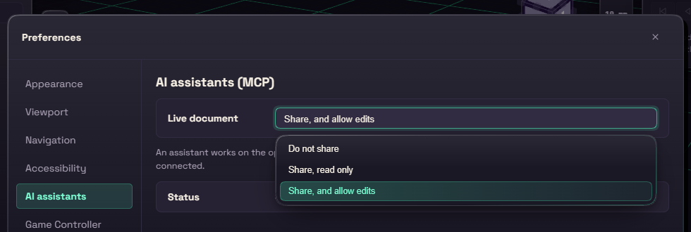

# Share your document

The Live document setting on the AI assistants page decides what an assistant may do with your open document.

Share, and allow edits lets the assistant change the document while you watch, and each change is one step Ctrl+Z can undo. Share, read only lets it look and measure. Do not share gives it a copy of its own.

Give the assistant real dimensions or a STEP file of what the part must fit, and ask it to use named parameters and save a `.funda` file.
