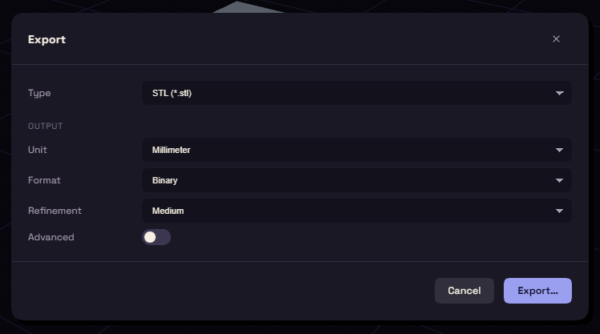

# Export

Press Ctrl+E, or choose File > Export…, to send a part to a slicer or another program.

## Pick a format

Type picks the format.

| Type | Use it for |
| --- | --- |
| STL, 3MF | A slicer. |
| STEP | Another CAD program, it keeps the exact surfaces. |
| GLB | A viewer. |
| DXF, SVG | A laser cutter or a drawing program, see below. |

## Settings

- **Bodies**: with several bodies, All in one file or Each body as its own file. With bodies selected, you can export only those.
- **Unit**: for STL and 3MF. Leave it on Millimeter, since a slicer reads the numbers as they are.
- **Format**: for STL, Binary or ASCII.
- **Refinement**: how finely curves are cut into triangles. Medium suits most prints, High suits large smooth curves, Low suits quick tests.
- **Advanced**: shows Surface deviation, Normal deviation and Maximum cell size, to set the triangles by hand. Changing them turns Refinement to Custom.

Press Export… and pick where the file goes. If a step failed, a warning names it, because its shape is missing from the file.

## A sketch or a flat face as DXF or SVG

DXF and SVG draw one sketch or one flat face at true size, in millimetres.

1. Right click a sketch in the Items card and choose Export as DXF… or Export as SVG….
   For a face, right click it in the view and choose Export face as DXF… or Export face as SVG….
2. Set Tolerance, then press Export….

You can also select the sketch or face and press Ctrl+E.

- A face keeps its holes, and its drawing lines up with a sketch on that face.
- Lines, arcs and circles stay exact. Other curves become short straight lines within Tolerance of the curve.
