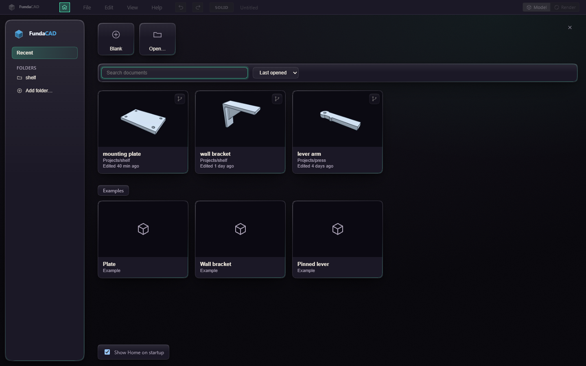

# Home

Home is where FundaCAD starts. It shows the documents you worked on, starts new ones and takes you back to any version of a document.

Click a card to open the document. Each card shows a picture of the model from its last save, the folder it is in and when it was last edited. A card marked Not found points to a file that was moved or deleted, click it to take it off the list.

Blank starts an empty document. A template starts one that already has parameters and a few steps, and Save then asks where to keep it. Open… finds a file on disk.

Type in the search field, or press Ctrl+F, to find a document by name or folder, and pick the order next to it. Esc in the search field clears it.

Add folder puts a folder of your own under Folders, to keep the documents of one project together. Home lists the documents in it and in its subfolders, and a document you start there is saved into it. Right click the folder and choose Remove from Home to take it off, the folder stays on disk.

Versions on a card lists the document's branches and saved versions. Open on a branch opens the document on that branch. Restore opens the document at that version, and Ctrl+Z undoes it. Open copy does the same as a new untitled document, so the original file stays as it is.

Press Esc or the close button to go back to your document. File > Home and the home button in the title bar bring Home back. Turn off Show Home on startup to start straight on an empty document.

Home sits on a plain paper background. In Preferences > Appearance, Home background can show your workspace dimmed behind it instead, or a PNG or JPEG picture of your own.

The pictures are kept on this computer, so a document copied from elsewhere shows its picture after you open it once.
