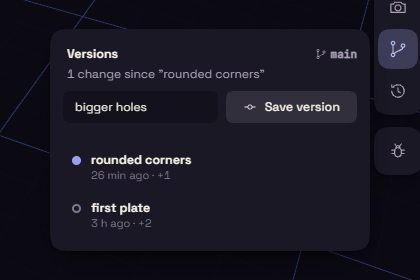

# Versions

Saving overwrites the file. A version is a checkpoint inside the file that you can go back to.

## Save a version

1. Open Versions in the view controls, on the right of the view.
2. Type what changed, such as "thicker walls".
3. Press Save version.

The panel counts the changes since the last version. Save version stays off while nothing has changed.

## Go back

Each row shows its note, when it was saved, and how many steps it added, changed or removed. Click a row to list those steps by name.

- Restore takes the document back to that version. Undo brings back what you had.
- Branch from here starts a separate line of work for a risky idea. Name the branch and press Create.

Once there is more than one branch, a list at the top of the panel switches between them.

## In the file

Versions travel inside the file. The Versions button on a card in [Home](home.md) lists them without opening the document.
