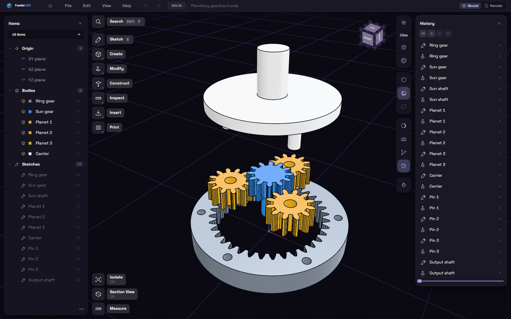

# FundaCAD

FundaCAD is a free, open source CAD program for designing parts you want to 3D print. You sketch a flat shape, give it exact sizes, turn it into a solid and export a file for your slicer.

Every step stays in the History, so you can change a number later and the rest of the part rebuilds. The tools are on the rail down the left side, and Ctrl+K finds any of them by name.

Start with [Install](start/install.md), then build a plate in [Your first part](start/first-part.md). FundaCAD is a rolling beta, so a page can be a little behind the app.
