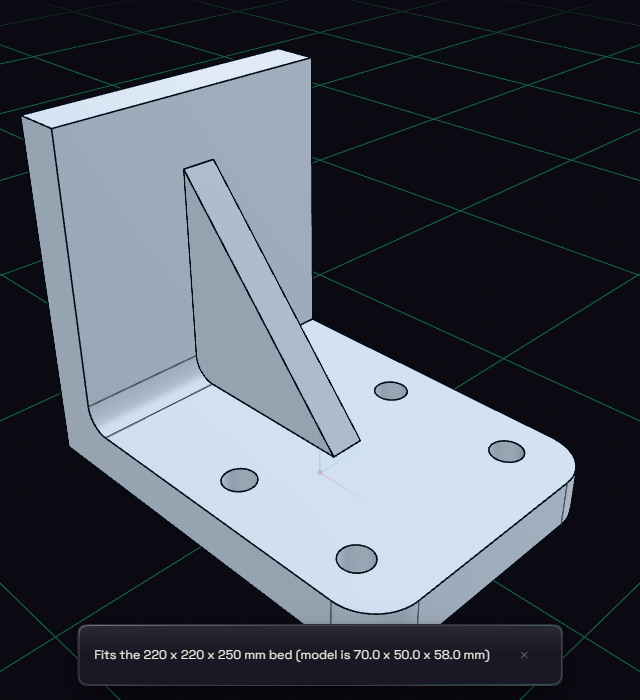

# Bed fit check

Bed Fit Check, under Print, tells you whether the part fits your printer.

Choose a bed size from the list, or Custom to type the width, depth and height. It says the part fits, or what percentage to scale it by. It uses the overall size only, so it does not try turning the part diagonally.
