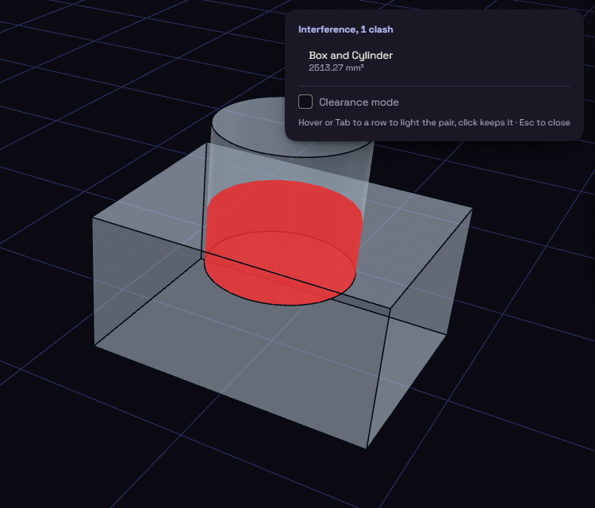

# Interference

Interference finds bodies that overlap, which you want to know before you print an assembly. It needs at least two bodies.

1. Under Inspect, open Analyze and pick Interference.
2. Each row is a button that names a pair of bodies, such as Box and Lid, with the volume of their overlap. The overlap is drawn in red in the view.
3. Hover a row, or Tab to it, to light that pair in the view. Move away and the lit pair goes back to the one you kept.
4. Click a row, or press Enter, to keep that pair lit. Press it again to clear it.
5. When a check ends, a screen reader says how many clashes it found, and how many close pairs and unchecked bodies. A check that fails is read out at once.

An overlap inside a part is hidden, so press X to see through the parts.

Turn on Clearance mode to also list pairs that come closer than a gap you type. It starts at 0.2 mm, a common gap for parts printed in place.

Only closed solids can be checked. A surface, or an import whose faces do not close, is listed as Not checked with the reason, so an empty list never hides it.
