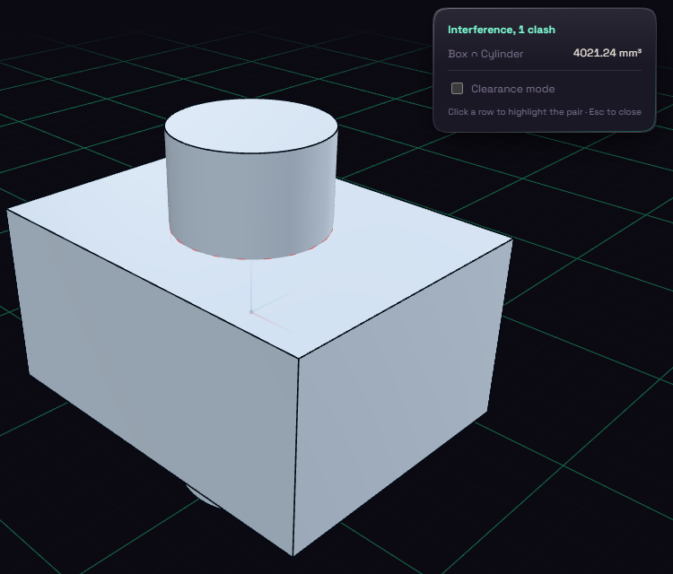

# Interference

Interference lists bodies that overlap, which you want to know before printing an assembly.

Each row names a pair and the size of the overlap, and a click highlights the pair. Clearance mode lists pairs closer than a distance you type, and 0.2 mm is a sensible first try.
