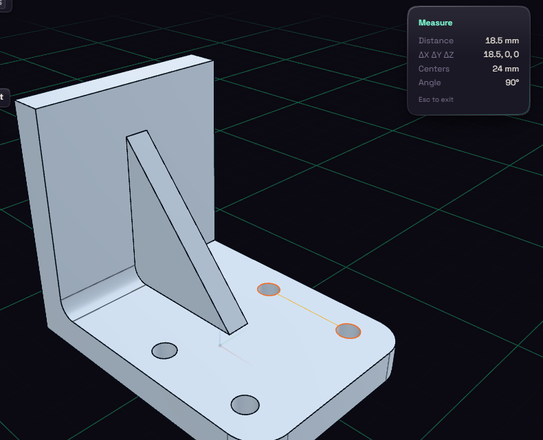

# Measure

Measure answers how long, how far apart or what angle, from things you click.

Press I and click a face or edge to see its area or length. A second click shows the shortest distance, that distance split into X, Y and Z, the distance between centres and the angle between them. A third click starts over.

The numbers follow your unit preference. On curved faces they come from the displayed mesh, so they can be off by a tiny amount.
