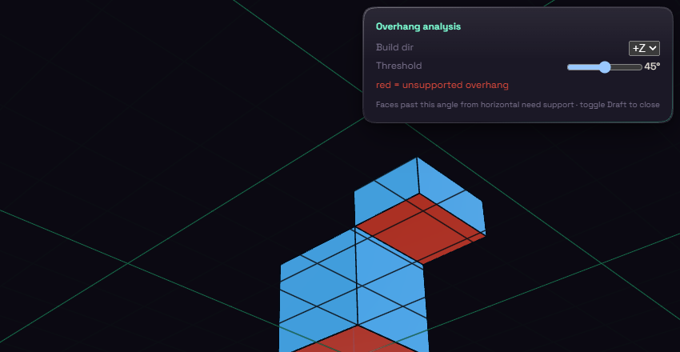

# Overhang

Overhang paints the faces that lean out too far to print without support, while turning the part is still cheap.

Pick Overhang under Inspect and red faces need support. Build dir is the direction your printer stacks layers and starts at +Z. Threshold is the angle past which a face counts as unsupported and starts at 45 degrees. Pick Overhang again to switch it off.
