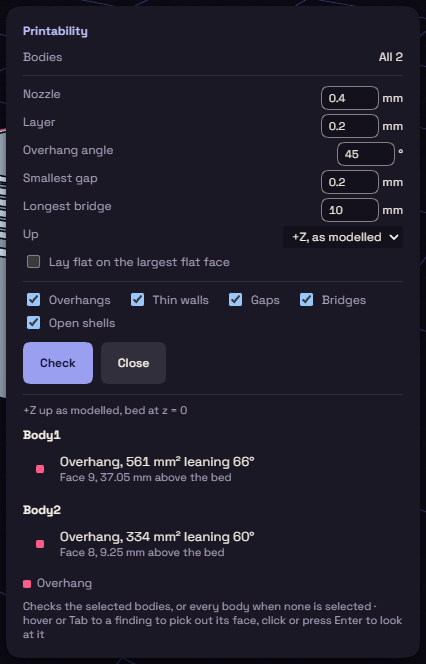

# Printability

Printability looks through the model and lists what is likely to go wrong when you print it. It comes with the [3D Printing Toolbox](../plugins/print-toolbox.md) plugin, under Print on the rail.

## Run a check

1. Select the bodies to check, or none to check them all. The Bodies line shows which.
2. Set the numbers in the table below to match your printer.
3. Pick Up, the side that faces up on the bed, or tick Lay flat on the largest flat face.
4. Tick the checks you want: Overhangs, Thin walls, Gaps, Bridges and Open shells.
5. Press Check. Press Cancel to stop a long check.

| Setting | At first | Flags |
|---|---|---|
| Nozzle | 0.4 mm | walls thinner than two nozzle widths |
| Layer | 0.2 mm | floors thinner than two layers |
| Overhang angle | 45° | faces that lean further than this |
| Smallest gap | 0.2 mm | gaps narrower than this |
| Longest bridge | 10 mm | bridges longer than this |

## Read the findings

Findings are listed per body, each with a colour that matches its tint in the view. A legend under the list names the colours. Under each finding is its place: the face number, as the Geometry tab shows it, and how high above the bed it sits. A finding between two faces names both.

1. Hover a finding, or Tab to it, to pick out its face.
2. Click a finding, or press Enter on it, to turn the view to it. The finding you picked stays marked as current.

## What a screen reader hears

When a check ends you hear the count, how many of each kind, and the largest overhang with its area and face, for example "Printability: 3 things to look at. 2 overhangs, 1 thin wall. Largest overhang 132 mm squared on face 4". A check that fails or is cancelled is spoken too. Tab then walks the findings, and each one is read with its place.

If you change the model, the tints go away. Press Check again to see them on the new model.

The check is a guide, your slicer has the last word.
