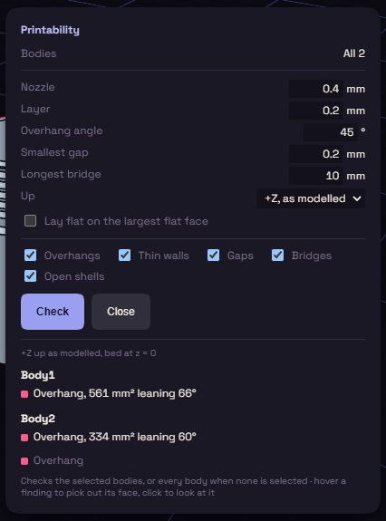

# Printability

Printability looks through the model and lists what is likely to go wrong when you print it. It comes with the [3D Printing Toolbox](../plugins/print-toolbox.md) plugin, under Print on the rail.

## Run a check

1. Select the bodies to check, or none to check them all. The Bodies line shows which.
2. Set the numbers in the table below to match your printer.
3. Pick Up, the side that faces up on the bed, or tick Lay flat on the largest flat face.
4. Tick the checks you want: Overhangs, Thin walls, Gaps, Bridges and Open shells.
5. Press Check. Press Cancel to stop a long check.

| Setting | At first | Flags |
|---|---|---|
| Nozzle | 0.4 mm | walls thinner than two nozzle widths |
| Layer | 0.2 mm | floors thinner than two layers |
| Overhang angle | 45° | faces that lean further than this |
| Smallest gap | 0.2 mm | gaps narrower than this |
| Longest bridge | 10 mm | bridges longer than this |

## Read the findings

Findings are listed per body, each with a colour that matches its tint in the view. A legend under the list names the colours.

- Hover a finding to pick out its face.
- Click a finding to turn the view to it.

If you change the model, the tints go away. Press Check again to see them on the new model.

The check is a guide, your slicer has the last word.
