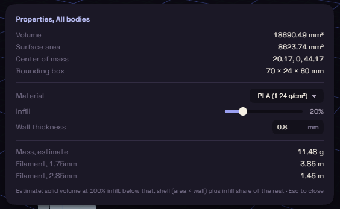

# Properties

Properties shows the size and weight of your bodies. Open it from the Analyze menu on the rail, or right-click a body and pick Properties.

It measures the selected bodies, or all bodies when nothing is selected. It lists:

1. Volume
2. Surface area
3. Center of mass, also marked in the view
4. Bounding box, as width × depth × height

Press Esc to close it.

## Print estimate

Below those is an estimate for printing. Your choices are kept for next time.

| Setting | At first | Options |
|---|---|---|
| Material | PLA | PLA, PETG, ABS, ASA, TPU, Nylon, or Custom… with a Density of your own |
| Infill | 20 % | 0 to 100 % in steps of 5 |
| Wall thickness | 0.8 mm | the outer shell, counted as solid |

It gives Mass, estimate in grams and the filament length in metres for 1.75 mm and 2.85 mm spools.

## A body that is not solid

A body with an open shell, or with faces that point the wrong way, has no inside to measure. Properties then says it is not a sound solid and names what is wrong with each body.

Its Volume, Center of mass and print estimate are left out. Surface area and Bounding box still show.

## Properties of a step

Clicking a step in the History opens its own properties, a different panel from this one. It follows the language picked in [Preferences](../reference/preferences.md), in its row names, choices, hints and notes, and it keeps its units as symbols. Typing a number works as before. A name you gave a step stays as you typed it, and the saved file is the same in every language.
