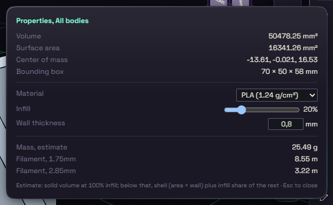

# Properties

Properties shows the volume, surface area, centre of mass and bounding box of the selected bodies, or of every body when nothing is selected.

Below those is a print estimate. Pick a material, an infill percentage and a wall thickness to get a mass in grams and the filament length.
