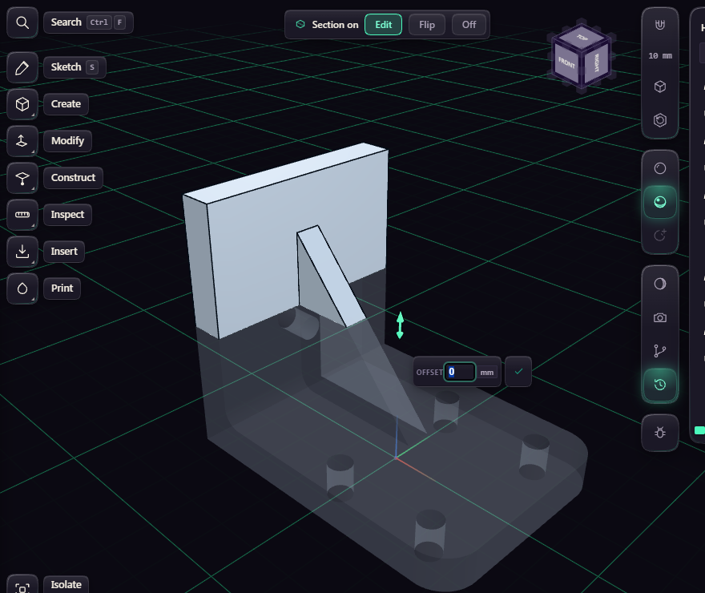
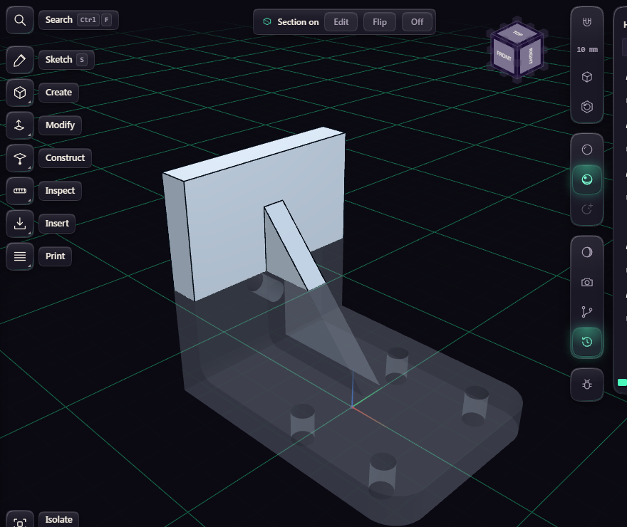

# Section

Section cuts the model open with a plane so you can see inside.

Pick Section under Inspect, then a face, a plane, or the Z, X or Y axis. Z gives a horizontal slice. Drag the handle or type a distance, press F to flip the kept half, and G to change how strong the faint ghost of the cut half is.

Press Enter, the check or Esc when the cut is where you want it. The handle goes away and the cut stays on while you orbit, select, measure and use other tools. Clicks only reach what the cut keeps.

While a cut is on, a chip at the top of the view says Section on. Edit brings the handle back, Flip keeps the other half, and Off removes the cut. Section on the rail turns it off too.

The cut is saved with the document and is back when you open it. Undo leaves it alone.
