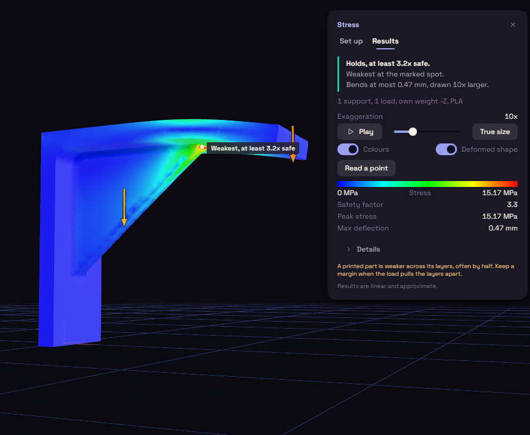

# Reading the stress result

When a run finishes, the Results tab opens and the part is coloured from lowest stress to highest. Set up takes you back to the inputs.

Results opens with a verdict in plain words: the part holds with its safety margin, holds with too thin a margin (under about 1.5x), or is likely to fail. A pin marks the weakest spot on the part, and the line under the verdict says how far it bends. When that spot is a sharp inside corner or the edge of a support, the verdict says it is a rough reading: the stress there keeps growing as the mesh gets finer, and rounding a sharp corner makes the part stronger. A small overload is given in percent, such as about 3% more than the part can take. The results give the safety factor, which is the yield strength divided by the peak stress, the peak stress and the largest deflection. Below 1 the panel flags it. Details holds the rest, such as the loads and reactions. A printed part is weaker across layer lines, so do not trust a number barely over 1.

Play swings the part between still and bent, and Pause holds it where it is. The Exaggeration slider draws the bend larger, True size draws it as it is, Colours turns the stress colours on and off, and Read a point reads the stress where you click. If you change the model or the setup after a run, Results says so and Run again brings it up to date. Closing the panel keeps the result, and opening Stress again shows it. The colours are drawn on the part as the model shows it, with the same edges and fillets, and each face is coloured from its own side, so colours can change sharply along a sharp edge. The solver solves once, makes its elements smaller where the stress changes fastest and solves again. The study is linear and approximate, so use it to compare designs and not to predict when a part breaks.
