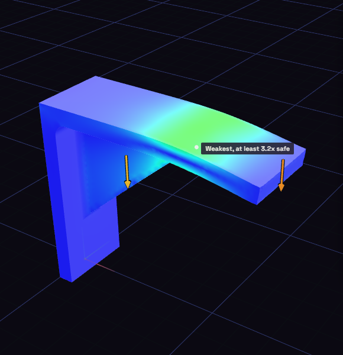

# Stress

Stress shows how a part bends and where the material works hardest, so you can tell whether a bracket or clip will hold.

1. Open Inspect, pick Stress, and choose the body.
2. Under Support 1, press Place and click near a screw hole. Add a support for each hole.
3. Under Load 1, press Place, click the shelf face, and type 50 for the force.
4. Pick your material, such as PETG, and press Run at the bottom of the panel.

A support is where the part cannot move. Fixed holds it everywhere, Pinned lets it turn, and Slider lets it slide along a face. A load is a Force in newtons or a Pressure in MPa. To load whole faces instead of a spot, select them in the view and press Use selected. Turn on Own weight to add the part's weight. More options holds the mesh size: smaller is finer and slower.
