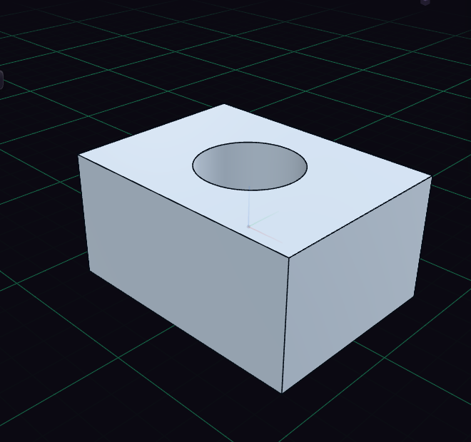

# Union, subtract and intersect

Union joins two bodies into one, Subtract removes one from another, and Intersect keeps only where they overlap. The keys are Ctrl+U, Ctrl+B and Ctrl+I.

Choose the tool with nothing selected, click the body to keep, then click the body to use on it. For Subtract the first body stays and the second goes away. With several bodies selected beforehand, the first one selected is kept.
