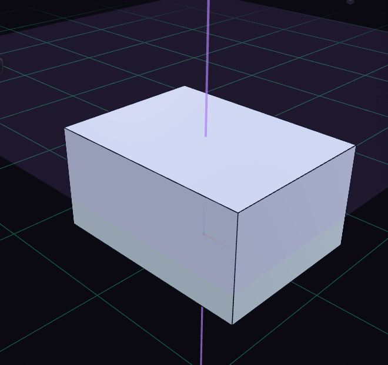

# Planes and axes

The Construct tools make reference geometry. It builds no solid, but it gives you somewhere to sketch or something to cut or spin around.

Offset Plane (O) is the one to know. Click a plane or flat face, drag the arrow or type a distance, and a sketch opens on the new plane.

Datum Plane adds rings that tilt the plane. Midplane sits halfway between two faces, and Plane, 3 Pts goes through three points. Datum Point and Datum Axis give you something to snap or revolve around, and Axis on Edge follows a straight edge.

