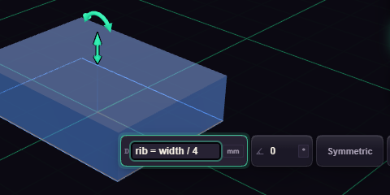

# Expressions

An expression is a small calculation you type where a number goes, such as `width / 2`.

Put a name and an equals sign first, as in `rib = width / 4`, to name the result. Units are mm, cm, in, deg and rad, so `1 in` is 25.4 mm. Without a unit, lengths are mm and angles are degrees.

The usual arithmetic works, with ^ for powers, PI, and functions such as sin, sqrt, min, max, round and if. Comparisons give 1 or 0, so `if(height > 60, 3, 2)` makes a wall 3 mm on tall parts and 2 mm on short ones.

