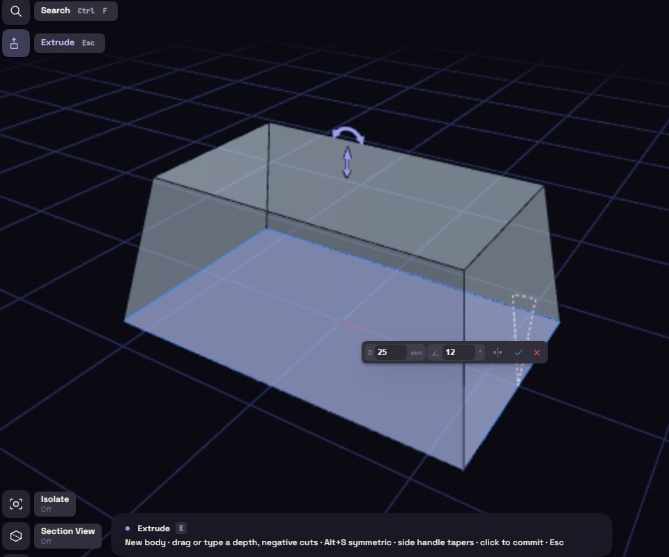
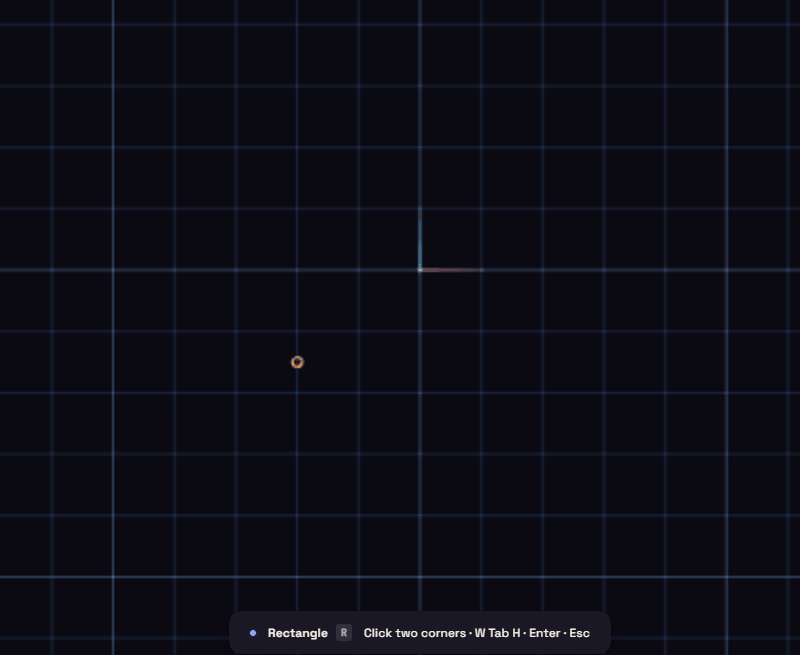
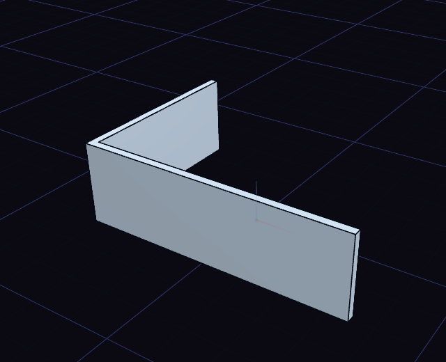

# Extrude

Extrude (E) pulls a closed shape from a sketch into a solid. It is the tool you reach for most.

Click the profile, drag the arrow or type a depth, and press Enter. Ctrl+click adds more areas, and an outline with a hole inside, such as a washer, keeps the hole open.

Dragging into material cuts and dragging away adds, so the same rectangle becomes a boss or a pocket. Alt+S extrudes both ways from the sketch, and the handle beside the arrow tapers the walls, up to 88 degrees.

With a flat face selected, E acts as Press/Pull on that face.

## Thin walls

Pick a sketch of open lines and arcs in the tree and press E, and Extrude makes a wall along them instead of a solid, 2 mm thick to start with. The Thin switch in the feature's rows turns any extrude into a wall along its sketch's curves, closed ones included, so a rectangle becomes a hollow frame. Thickness sets how thick the wall is, and Wall side puts it centred on the curves, inside, outside, or both ways with a second thickness. Inside is the enclosed side of a closed outline, the side an open chain bends toward, and the left of a single straight line as drawn. Corners are mitred, and walls that cross or meet become one body. Lines, arcs, circles, rectangles, polygons and slots can carry a wall, splines and ellipses not yet.

