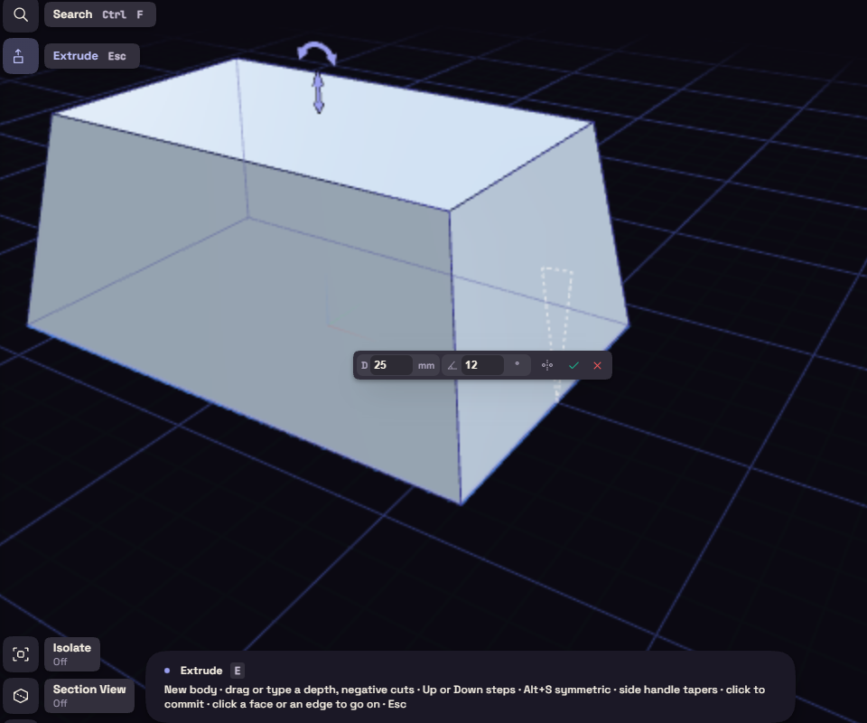
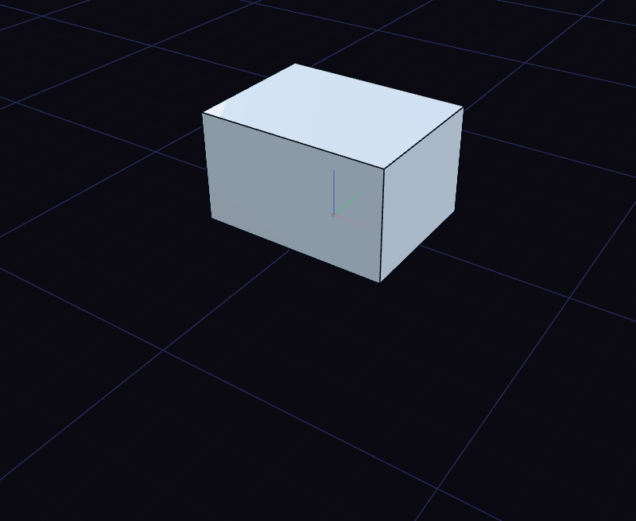
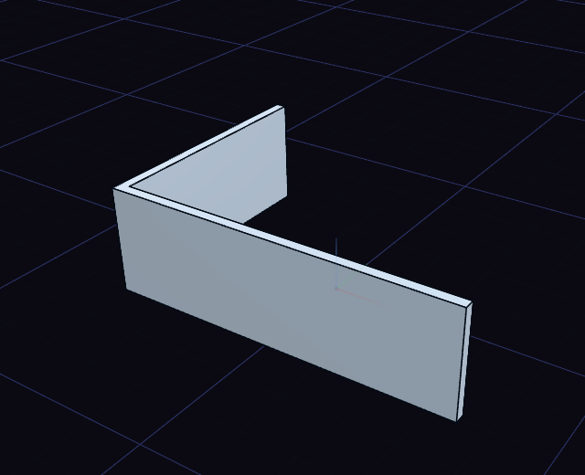

# Extrude

Extrude (E) pulls a closed shape from a sketch into a solid. It is the tool you reach for most.

1. Click the profile. Ctrl+click adds more areas.
2. Drag the arrow, or type a depth. Up and Down [step it by keys](../reference/shortcuts.md#value-box-keys).
3. Press Enter. Or click a face or an edge: the extrude is made, and Press/Pull or Fillet starts on what you clicked.

{ .fc-motion }

Dragging into material cuts and dragging away adds, so one rectangle makes a boss or a pocket. An outline with a hole inside, such as a washer, keeps the hole open.

Alt+S, or Symmetric in the box, extrudes the same depth both ways from the sketch. The handle beside the arrow tapers the walls up to 88 degrees, or type the taper in the Angle box.

With a flat face selected, E works as Press/Pull on that face.

## Carry on

Once the depth is set, because you dragged the arrow and let go or typed a value, the next click on a face or an edge finishes the extrude and carries on. A face starts Press/Pull on it, an edge starts Fillet on it. The face is found again on the finished solid, so a click on the new top face pushes that new face. If the face or edge is not on the result, the extrude is still made and the status says to pick it again.

While the depth still follows the pointer, a click sets it and finishes the extrude, nothing more. Hover lights the face or edge a click would take. A refused preview refuses the click as well, the step stays open and the status says why. Ctrl+Z takes the extrude back in one go and closes the tool that started from it. The brackets and Enter on the 3D view, or a row in the Geometry list, do the same as a click, but the list only shows faces and edges the model had before the extrude. To go on from a new face by keyboard, press Enter in the value box first, then step to it. Enter and Accept finish without starting anything, and editing an extrude from History never carries on.

## Start and end

The step's rows change where the solid starts and stops after it is made.

1. Start: Sketch plane, Offset, Face, Plane or Point.
2. End: Distance, Up to face, Up to plane, Up to point or Through all. An Up to end ignores the distance, and End offset runs past the target, or stops short when negative.
3. Two sided: the second side gets its own distance, taper and end.
4. Operation: New body, Join, Cut or Intersect.

## Thin walls

Pick a sketch of open lines and arcs in the Items card and press E, and Extrude makes a 2 mm wall along them instead of a solid.

The Thin switch in the step's rows turns any extrude into a wall along its sketch's curves, so a rectangle becomes a hollow frame. Thickness sets the wall, and Wall side places it:

1. Centered on the curves, the default.
2. Inside: the enclosed side of a closed outline, the side an open chain bends toward, or the left of a straight line as drawn.
3. Outside: the other side.
4. Two sides: Thickness inside and Thickness 2 outside.

Corners are mitred, and walls that cross or meet become one body. Lines, arcs, circles, rectangles, polygons and slots can carry a wall, splines and ellipses not yet.
