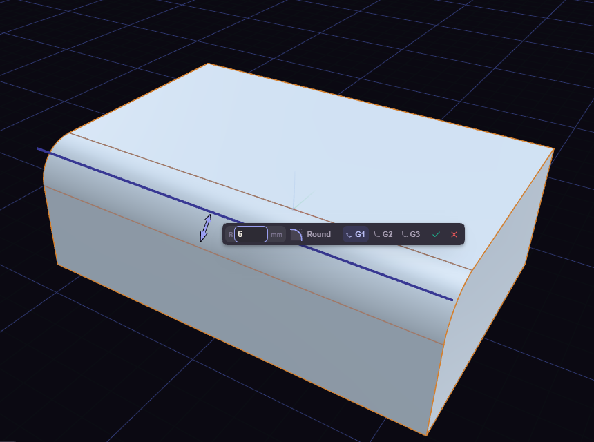
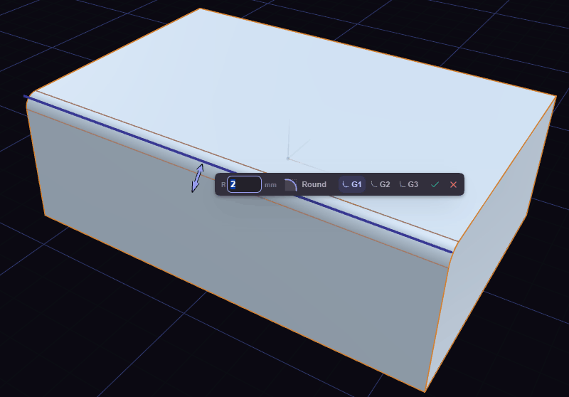

# Fillet and chamfer

Fillet (F) rounds an edge and Chamfer (B) cuts it at an angle.

Click an edge, drag or type a size, and press Enter. Selecting a face first treats every edge around it. Tab swaps between fillet and chamfer without starting over.

The two profile icons in the fillet box pick the continuity in one click. G1 is a circular round. G2 eases into the faces with no jump in curvature, so the highlight runs on smoothly. Keys 1 and 2 pick them too, or Alt+1 and Alt+2 while you type the size.

A click takes the whole run of edges that flow smoothly from the one you picked. Shift+click takes exactly one. If the size is too big for the shape, the prompt says so and you type a smaller one.

## Continuity

A fillet's continuity sets how it meets the faces. G1 (key 1) is a circular round. G2 (key 2) eases in with no jump in curvature, so reflections run on without a kink; it sets back 1.55 times the radius. G3 (key 3) also has no jump in how fast the curvature changes, the smoothest of the three; it sets back 1.46 times the radius. The profile works with all three.

G2 and G3 need both faces flat across the edge: a line between two flat faces at any angle, inside or outside, a flat face meeting a cylinder or cone around its rim, and the corner where three square faces meet with equal radii. On an edge that runs along a curved face, such as a flat face meeting a cylinder along its length, or any edge of a sphere, torus or freeform face, G2 and G3 are greyed out with the reason in their tooltip, and a document that asks for them there is refused with a message that offers G1.
