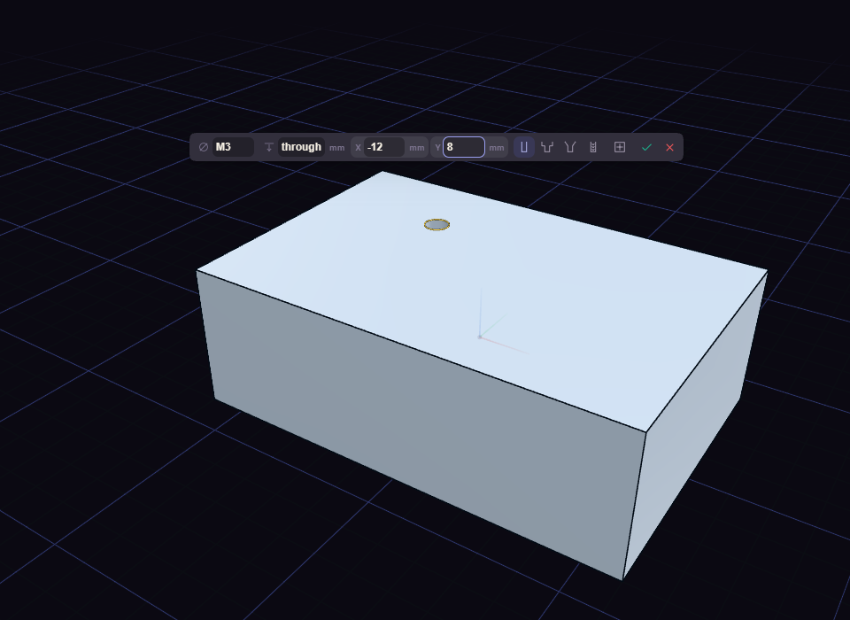

# Hole

Hole drills holes into a flat face, ready for a screw.

Click the face where the hole goes, then set the Size from M2 to M20, the Depth and the position. Type `through` as the depth to drill all the way. Click the face again for another hole, and press Enter to finish them all.

The type button cycles between Simple, Counterbore, Countersink and Insert, where Insert sizes the hole for a brass heat-set insert. Fit can be Close, Normal or Loose.
