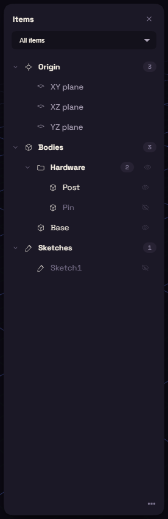

# The Items card

The Items card lists what is in the document. Ctrl+Alt+S shows or hides it.

Origin, Bodies and Sketches are always there. Planes, Datums, Joints and Mechanisms appear once you have one. The list at the top shows only one kind: All items, Bodies, Planes and axes, or Sketches.

## Rows

1. Click selects a row, Ctrl+click adds one, and Shift+click takes a run.
2. Click a plane under Origin to start a sketch on it.
3. Double-click renames a body or edits a sketch.
4. Right-click a body for Move to, Material, Visibility, Rename and Delete.

## Hiding

1. Click a row's eye to hide or show it, or drag across several eyes.
2. Alt+click an eye to show only that row, and Alt+click it again to bring the rest back.
3. H hides the selected bodies, and Shift+H shows them all.

A hidden body is left out of any join, cut or intersect, unless the step names it as a target.

## Elements

An element is a folder for bodies.

1. Right-click the Bodies heading and choose New element.
2. Drag bodies onto the element. Dropping one body onto another puts both in a new element.

Clicking an element selects every body inside it, and its eye hides or shows them all.

## The Geometry tab

The Geometry tab, beside Items, lists the faces, edges and planes of a body in words. It is one way to find and pick them, clicking in the view is another, and both make the same selection. Browse Faces and Edges, in the Edit menu and the command palette, opens the tab and puts focus on the list.

| Row | Beside it |
| --- | --- |
| Flat face 4 | 60 by 40 mm, facing up, Extrude 1 |
| Hole 7 | diameter 10 mm, 20 mm long, Hole 1 |
| Straight edge 11 | 40 mm, faces 4 and 7 |
| XY plane | origin |

The number is the row's place on its body, and it can change after a build. The list also holds faces and edges a click cannot reach because something is in front of them. Hidden bodies, and edges hidden by the tangent edge setting, are left out.

### What it lists

1. Body picks the body to list. It follows the selection, and changing it leaves the selection alone.
2. Faces, Edges and Planes pick the list. Planes holds the origin planes and your datum planes.
3. Type and Facing narrow the list. Edges have no facing, and planes have only Facing.
4. Size at least compares a flat face's long side, the diameter of a cylinder, sphere or torus, an edge's length, and for any other face the square root of its area.
5. Clear filters appears when nothing matches.

A list shows 100 rows at a time. Previous and Next turn the page, and the count beside them says where you are.

### Keys in the list

| Key | What it does |
| --- | --- |
| Up, Down | Move and light the row. At the end of a page they turn it. |
| Home, End | Go to the ends of the page. |
| PageUp, PageDown | Turn the page and say its range, such as 101 to 200 of 2,002. |
| Enter | Select this row only. On a plane, start a sketch on it. |
| Space | Add or remove this row. |
| Shift+Up, Shift+Down, Shift+Space | Take a run of rows on this page. |
| Ctrl+A | Take every row on this page. |
| A letter | Jump to the next row starting with it. Tool keys such as S and F do not run here, F6 goes to the 3D view, where they do. |
| Esc | Clear the selection. Focus stays on the row. |

Delete and Backspace do nothing here, so a key press in the list never removes a face. With a face picked, they say that Delete works in the 3D view and that F6 goes there. A click on a row picks as these keys do, and Ctrl+click and Shift+click add to it. If a tool is waiting for a pick, Enter or a click on a row gives it that plane, face or edge instead, and so do the brackets and Enter on the 3D view. What each takes from a row:

1. Sketch: a plane or a flat face.
2. Section and Mirror: a flat face, for the plane.
3. Fillet and Chamfer: edges, added, or taken out again if already in.
4. Press/Pull, Draft, Offset Face, Thicken, Shell and Text: a face. Press/Pull also takes the face to stop at.
5. Hole: a flat face. Thread and Axis from cylinder: a round face.
6. Revolve: a straight edge, for the axis. A circular pattern: a face or an edge, for the axis.
7. Measure and a mechanism joint: faces and edges.
8. Stress, Click faces: faces.
9. Editing a feature's faces, edges or bodies: rows from the lists, a second row of the same takes it out.
10. Points for a datum plane, point or axis: a datum point row.

A row the tool cannot use is refused aloud, and the pick keeps waiting.

A sketch started from the list moves focus to the 3D view, so its keys draw. When keys started it, focus comes back to the list when the sketch ends, as it does for other tools started by keys. After a click on a plane row focus stays in the 3D view, where tool keys such as E run.

To go on from a pick, see [Pick with keys](picking.md#pick-with-keys).
