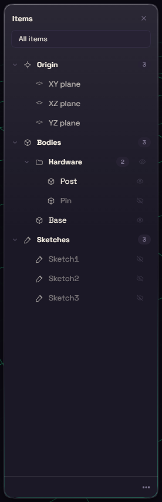

# The Items card

The Items card lists everything in the document under Origin, Bodies and Sketches, plus sections for planes, datums and joints once you have some.

Click selects a row, Ctrl+click adds one, and Shift+click takes a run. Double-click renames a body or edits a sketch. Ctrl+Alt+S shows or hides the card.

Each row has an eye. Drag across several to hide a run, and Alt+click shows only that one. A hidden body is left out of any extrude, join, cut or intersect unless the step names it as a target.

Right-click the Bodies heading and choose New element to make a folder, then drag bodies onto it. Selecting a folder selects everything inside.
