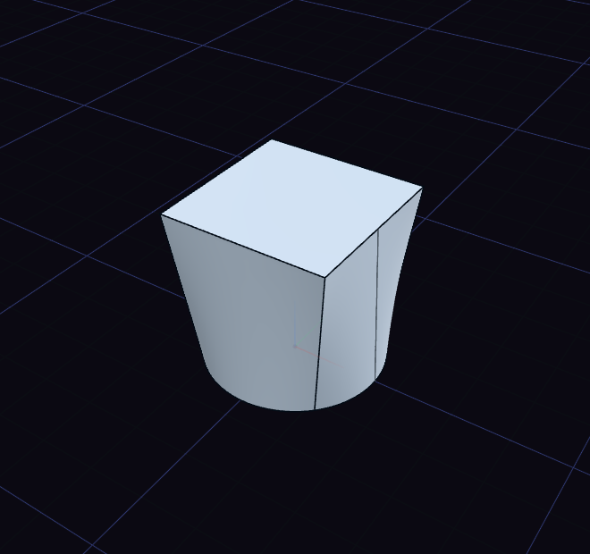

# Loft and sweep

Loft blends between profiles, and Sweep pushes a profile along a path.

## Loft

1. Draw each profile in its own sketch on a different plane, such as a circle and a square.
2. Choose Loft and click the profiles in order.
3. Press Enter.

Clicking a profile again drops it. A ring keeps its hole, so two rings loft into a tube.

## Sweep

1. Draw a closed profile in one sketch and an open curve, the path, in another.
2. Put the profile at the start of the path, roughly square to it.
3. Choose Sweep and click the profile. With more sketches to choose from, pick the path sketch in the list.

The step's Operation row joins a loft or sweep to a body, or cuts it away.
