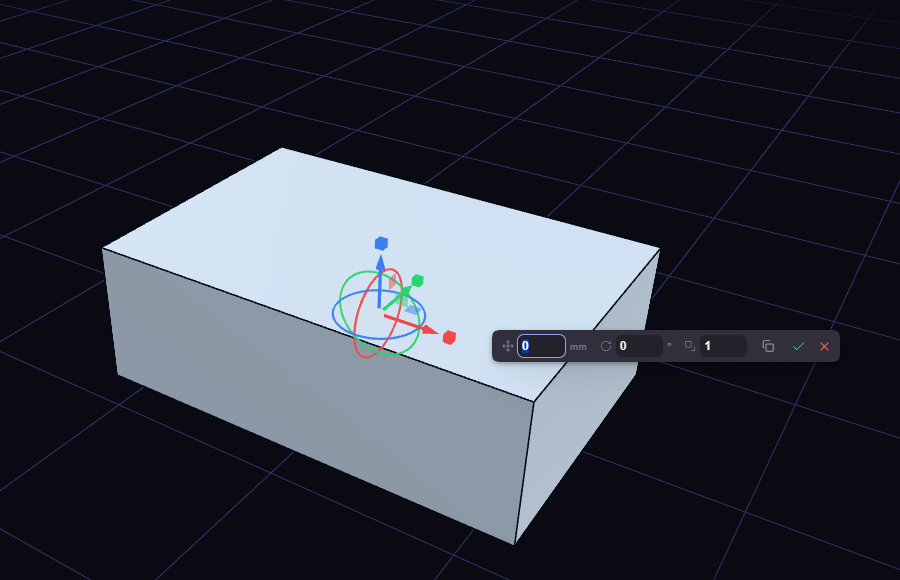

# Move

Move (M) places a body somewhere else.

Select the body first, or Move takes the most recent one. Arrows slide along an axis, squares slide in a plane, and rings turn the body. Dragging snaps to round steps, and Shift makes them finer.

Letting go of a handle keeps the gizmo up with the value in its box. Press Enter to apply every drag since the last Enter as one step, or Esc to drop them. Switch on Copy in the box, before or after dragging, to move a copy and leave the original. Ctrl+Z before Enter drops only the drags not yet applied.
