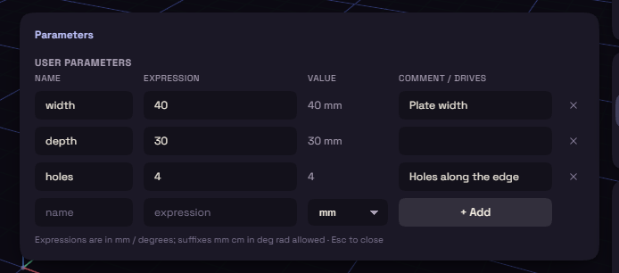

# Parameters

A parameter is a number with a name. Make one called `width`, use it in three places, and change it once.

## Add one

1. Pick Parameters under Modify on the rail.
2. In the bottom row, type a name and an [expression](expressions.md), and pick mm, deg or unitless.
3. Press + Add.

## Use one

Type the name in any value box where a number goes, such as `width`. The value is then tied to the parameter, and changing the parameter rebuilds every step that uses it.

A tied value shows `fx:` in front of it, and hovering its row shows the parameter and its value. Dragging a handle will not overwrite it.

## Edit and delete

- Change a name or an expression right in its row. A new name follows everywhere the parameter is used.
- The comment is a note for yourself.
- The x at the end of a row deletes the parameter, unless something still uses it. Hover the x to see what.

## Model parameters

Typing a name or a formula into a step's value makes a model parameter for it, named d1, d2 and so on. They are listed under Model Parameters with the value each one drives, and go away with their step.
