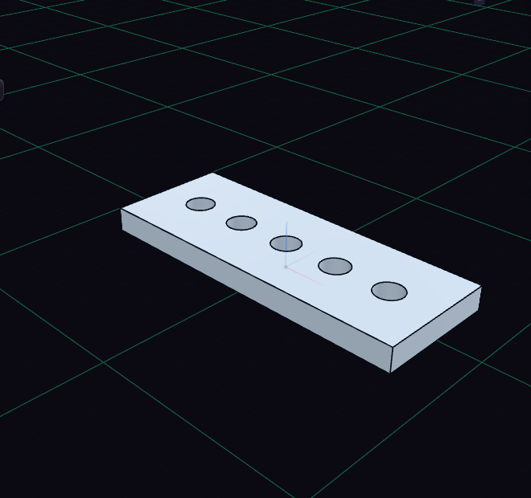

# Linear and circular pattern

Linear Pattern repeats a body along a line, and Circular Pattern repeats it around an axis.

Select the body first. If you select a face that a cut made, such as the wall of a hole, the pattern repeats that cut, which gives a row of holes from one.

Drag the arrow to set the spacing, and press [ or ] to change the count. For a circular pattern, click an edge to turn about, or press C to switch between the origin and the middle of the part.
