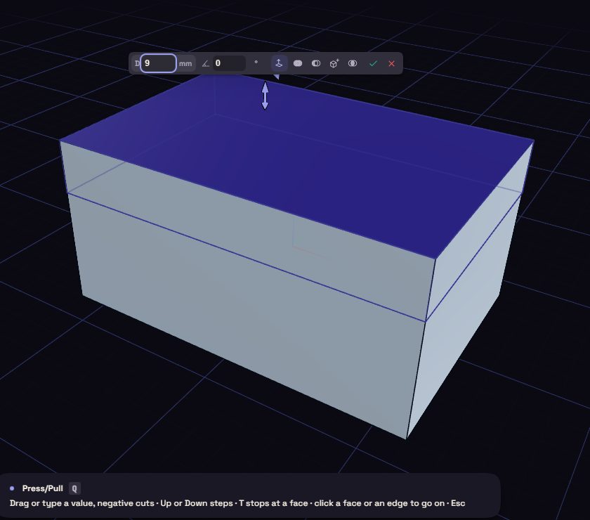
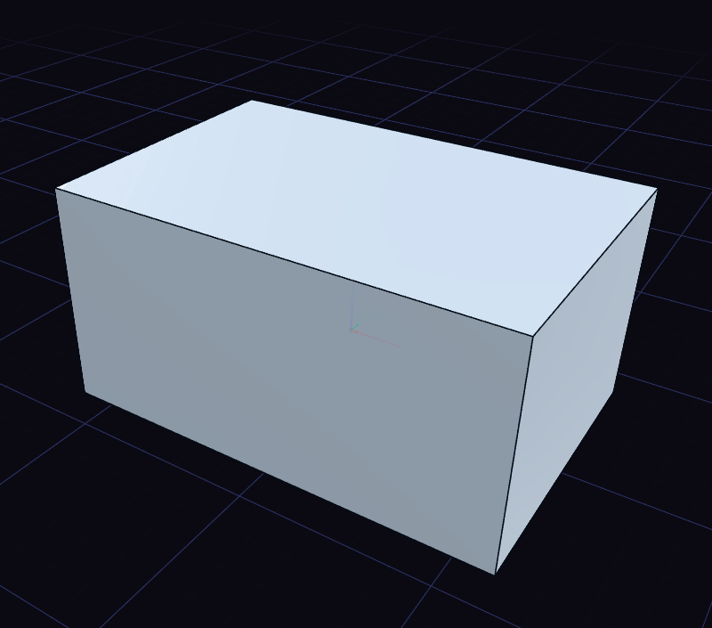

# Press/Pull

Press/Pull (Q) moves a face in or out, and the body grows or shrinks with it. It is the quickest way to make a wall 2 mm thicker.

1. Click a flat face. Ctrl+click adds more faces of the same body.
2. Drag the arrow, or type a distance. A negative distance cuts.
3. Press Enter, or click empty space. A click on another face or an edge makes the push and starts Press/Pull or Fillet there.

{ .fc-motion }

Letting go of the arrow does not finish the push, so you can still change the box before Enter. Esc drops it. In the box, Up and Down [step it by keys](../reference/shortcuts.md#value-box-keys).

## Stop at a face

Press T, then click the face to stop at, and the face moves up to it. Once you type in the value box, T is a letter there instead. Without T, a click on a face carries on instead, see below.

## Carry on

A click on a face or an edge finishes the push and carries on. A face starts Press/Pull on it, an edge starts Fillet on it, and the face or edge is found again on the finished solid. Hover lights what a click would take. If the push is still at zero, it adds nothing and the click just switches to that face. A refused push refuses the click, the step stays open and the status says why. Ctrl+Z takes the push back in one go and closes the tool that started from it. Ctrl+click still adds a face to the push, and a click on empty space or on a face being pushed still finishes it. The brackets and Enter on the 3D view, or a row in the Geometry list, do the same as a click, but the list only shows faces and edges the model had before the push. To go on from a new face by keyboard, press Enter in the value box first, then step to it.

While a push is open, the body is drawn solid with an outline of what the push adds, or in the error colour what it cuts out.

## Box options

1. Angle slopes the sides as the face moves, like a draft. The curved handle beside the arrow drags it.
2. Auto grows or shrinks the face. Join, Cut, New and Intersect extrude it instead and combine it with any body it reaches.
3. Along axis shows on the end of a hole. It slides the end down the hole, so the hole gets deeper. Along normal offsets the face.

## Round faces

On a round face, such as the wall of a hole, the drag resizes it. The box starts at the size the face has now.

1. Pick R, Diameter or Offset in the box, or type r2.5, d5 or +0.5.
2. Shrinking a full round under a tenth of its radius removes the face when you press Enter.
3. Tangent faces follow, on by default, moves the faces that run smoothly into it too, so a slot narrows as one. Off, a size they cannot meet is refused.
