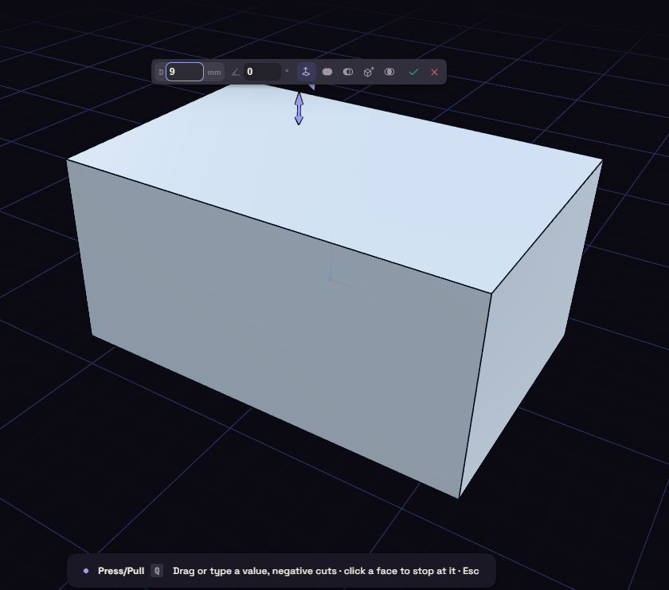
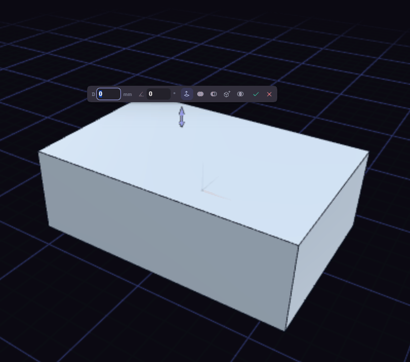

# Press/Pull

Press/Pull (Q) moves a face in or out, so the body grows or shrinks with it. It is the quickest way to make a wall 2 mm thicker.

Pick a flat face and drag the arrow, or type a distance, where a negative number cuts. Ctrl+click adds faces, and T lets you click another face to stop at.

Faces that run smoothly into the moved one come along. On a round face, such as the wall of a hole, you type a radius or diameter.
