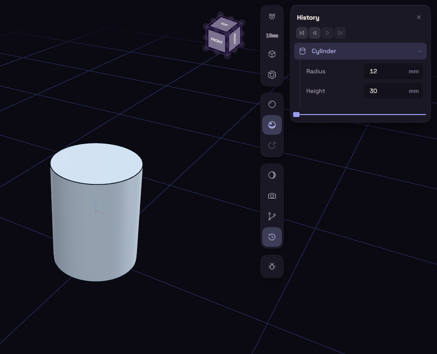

# Ready-made shapes

Primitive, under Create on the rail, makes a box, cylinder, cone, sphere or torus in one click.

1. Click Primitive and choose a shape.
2. Change its sizes in the step's rows in the History card.
3. Place it with Move, since every shape starts centred on the origin.

| Shape | Rows | Starts at |
|---|---|---|
| Box | Length, Width, Height | 20 mm each |
| Cylinder | Radius, Height | 10 and 20 mm |
| Cone | Bottom radius, Top radius, Height | 10, 0 and 20 mm |
| Sphere | Radius | 10 mm |
| Torus | Ring radius, Tube radius | 15 and 5 mm |

Primitives make good cutting tools. Put a cylinder where a hole should go, then use Subtract.
