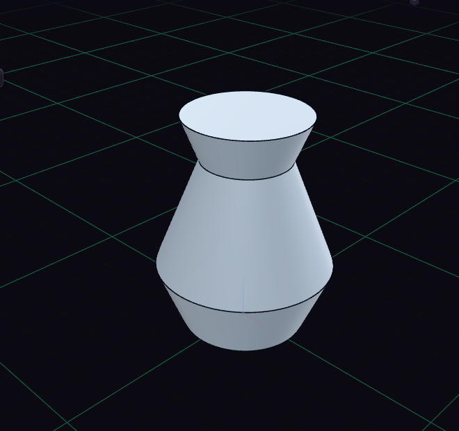

# Revolve

Revolve spins a profile around an axis, which makes bottles, knobs and pulleys.

Draw half the outline on one side of the axis. Choose Revolve, click the profile, then click an origin axis or a straight edge to spin around. A full turn is the default, and the Angle row of the step changes it.
