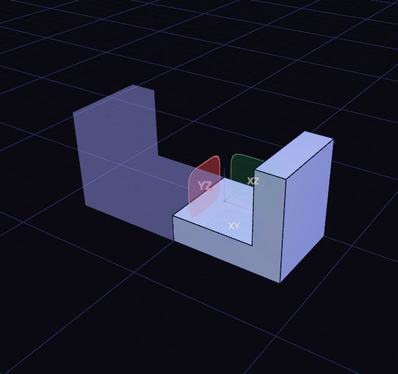

# Scale and mirror

Scale resizes a body by a factor, so 2 doubles every dimension. Mirror reflects a body and joins it to the original.

Set the factor in the value rows of the Scale step. The X, Y and Z factor rows stretch one axis only.

Mirror opens a small panel with two fields: Objects, the bodies to mirror, and Mirror plane. Bodies you selected first are already in Objects. Click a body to add it and the panel moves on to the plane; Shift or Ctrl click adds more bodies. For the plane, click XY, XZ or YZ in the panel, a plane or datum plane in the view, or a flat face of the part. A flat face adds a datum plane named Mirror plane that follows the face. The icon beside a field makes it the one your clicks fill, and the cross clears it.

A see-through copy shows the result. Press Enter or click Mirror to apply it, or Esc to cancel. Model half of a symmetric part and finish it in one step.
