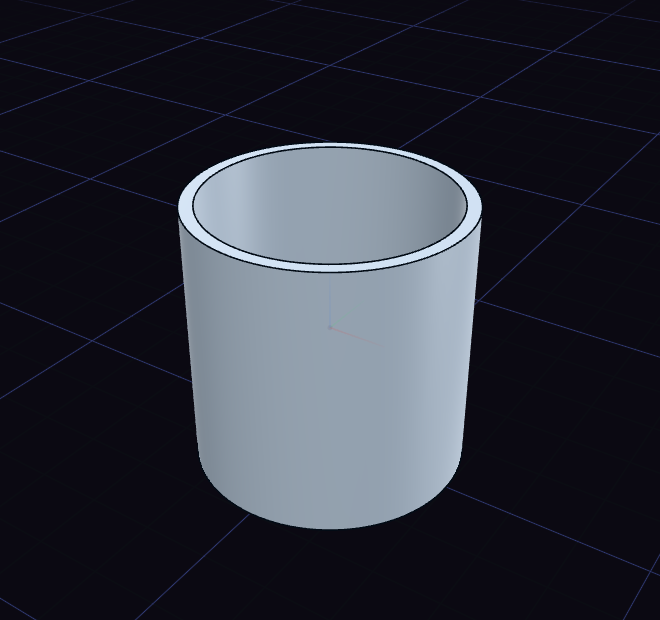

# Shell and thicken

Shell hollows a body, and Thicken gives a face a wall of its own.

For Shell, click the faces that should open, then drag or type the wall thickness and press Enter. Letting go of the arrow keeps the tool open, so the box options can still change. A mug is a cylinder with its top shelled to a few millimetres.

For Thicken, click the face and set the thickness, and press S to grow the wall on both sides. Its Operation row chooses between New body and Join.
