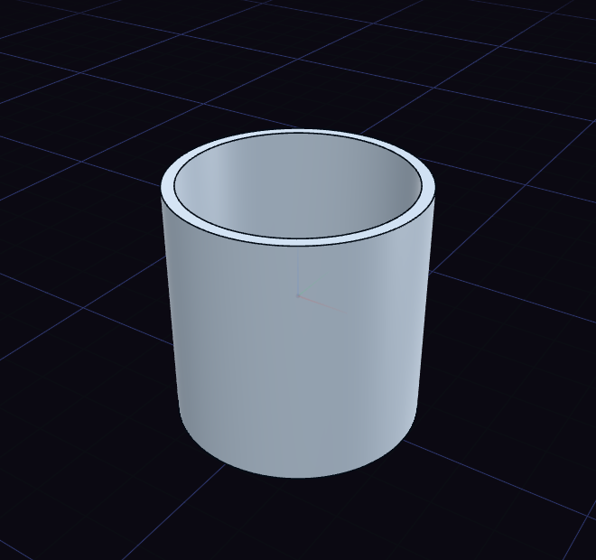

# Shell and thicken

Shell hollows a body, and Thicken gives a face a wall of its own. Both are under Modify on the rail.

## Shell

1. Click Shell, then click the face that should open. Ctrl-click opens more faces. Faces you select first open too, and on several bodies each face opens on its own body.
2. Drag the arrow or type the wall thickness.
3. Press Enter or click to apply, or Esc to cancel.

Letting go of the arrow only ends the drag, so you can still type a value. A mug is a cylinder with its top face shelled to a few millimetres.

A shell remembers the body of each face. If deleting an earlier step takes that body's number away, the step says the target body no longer exists, so pick its faces again in the History card.

## Thicken

1. Click Thicken, then click the face. Ctrl-click adds more faces.
2. Drag the arrow or type the thickness. Press S to grow the wall on both sides. Once you type in the value box, S is a letter there instead.
3. Press Enter or click to apply.

The step's rows in the History card change it later. Operation picks New body or Join, the default, and Symmetric is the same as S.
