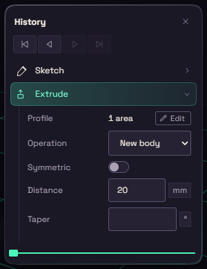

# History

Every sketch, extrude and fillet adds a step to the History card. The model is those steps run in order, so change a number in one and everything after it rebuilds.

Ctrl+Alt+H shows or hides the card.

## Working with steps

1. Click a step to open its values under it, and click it again to fold it.
2. Double-click a step to edit it with its own tool. Esc goes back.
3. Press F2 to rename the selected step.
4. Ctrl-click or Shift-click to take several steps, then right-click to suppress or delete them together.
5. With something selected, Related to Selection shows only the steps that made it.

Right-click a step for Edit, Rename, Suppress, Add condition, Roll back before this, Roll to here and Delete. Delete, by menu or by the Delete key, says what went, like "Deleted Extrude 1" or "Deleted 3 steps", and the message has an Undo button that stays for 15 seconds. The button only works while the delete is still the last step, so it never takes back something you did after. Ctrl+Z works as always. [Reorder and suppress](suppress.md) has more on suppressing and conditions.

## Undo and Redo

Ctrl+Z takes back the last step and Ctrl+Shift+Z puts it back. Both name the step, so a screen reader says "Undid Fillet 2" or "Redid Fillet 2", "Undid edit of Fillet 2" when only a change to it was taken back, and "Nothing to undo" when there is nothing left. In a sketch, Ctrl+Z takes back a sketch edit instead.

## Failed steps

A failed step is red, and hovering it tells you why. An amber step built, but has a note for you.

The red count on the card's header says how many steps fail. Click it to jump to the next one.

## Rolling back

The marker between the steps switches off everything after it. Drag it, or use the four arrows under the header: to the start, one step back, one step forward and to the end.

Roll back before this on a step's menu is a quick way to find which step causes a problem.
