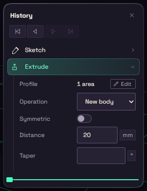

# History

Every sketch, extrude and fillet adds a step to the History card. The model is those steps run in order, so change a number in one and everything after it rebuilds.

Ctrl+Alt+H shows or hides the card.

## Working with steps

- Click a step to open its values under it, and click it again to fold it.
- Double-click a step to edit it with its own tool. Esc goes back.
- Press F2 to rename the selected step.
- Ctrl-click or Shift-click to take several steps, then right-click to suppress or delete them together.
- With something selected, Related to Selection shows only the steps that made it.

Right-click a step for Edit, Rename, Suppress, Add condition, Roll back before this, Roll to here and Delete. [Reorder and suppress](suppress.md) has more on suppressing and conditions.

## Failed steps

A failed step is red, and hovering it tells you why. An amber step built, but has a note for you.

The red count on the card's header says how many steps fail. Click it to jump to the next one.

## Rolling back

The marker between the steps switches off everything after it. Drag it, or use the four arrows under the header: to the start, one step back, one step forward and to the end.

Roll back before this on a step's menu is a quick way to find which step causes a problem.
