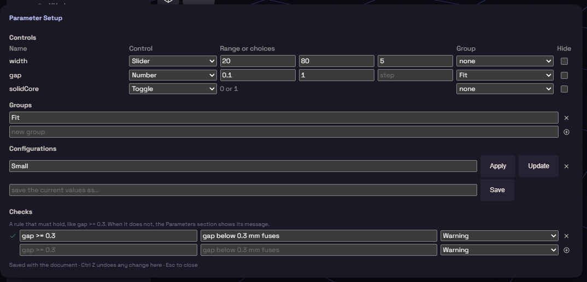

# Extra Parameters

This plugin gives your [parameters](../model/parameters.md) sliders, groups, saved sets of values and warnings. It is on by default.

Once you have a parameter, a Parameters section appears in the Items card. A slider commits when you let go, so one drag is one undo step.

## Parameter Setup

Open it from the button on the Parameters section header, or from Edit, Parameter Setup. It has four parts.

| Part | What it does |
| --- | --- |
| Controls | Gives each parameter a Number, Slider, Toggle or Choice, a range or choices, a group, and Hide |
| Groups | Headings to file parameters under |
| Configurations | Named sets of values, such as "Small". Apply sets them back, Update saves the values of now |
| Checks | A rule and a message, such as `gap >= 0.3` with "gap below 0.3 mm fuses", as a Warning or an Error |

Once you save a configuration, pick it from the Configuration list at the top of the Parameters section. A failed check shows its message there.

## An optional part

A toggle can switch a step on and off.

1. Add a parameter such as `solidCore` and give it a Toggle.
2. Right click the step on the timeline and choose Add condition.
3. Type `solidCore` in its Active when field.

The step builds while the toggle is on and is skipped while it is off.
