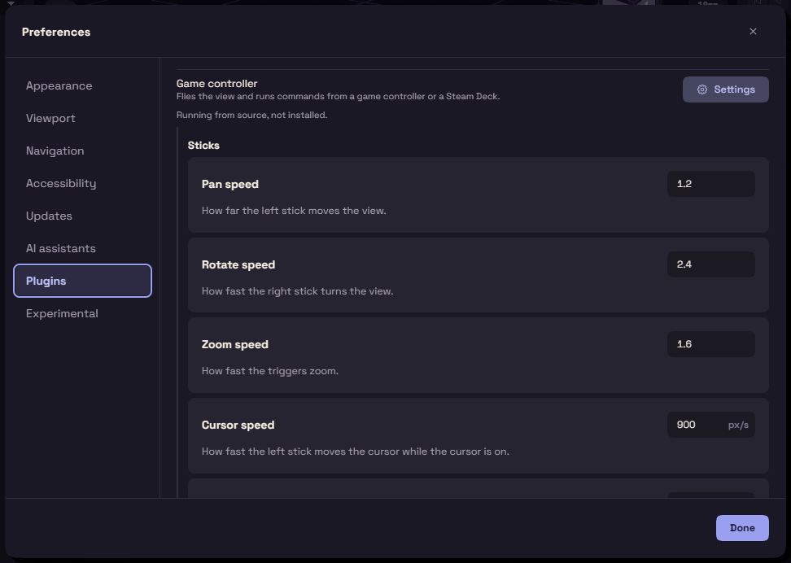

# Game controller

This plugin lets you move around the model with a game controller. It is on by default and does nothing until one is connected.

Plug it in and press any button, because FundaCAD only notices a controller after its first press. The left stick pans, the right stick rotates, and the triggers zoom.

| Button | What it does |
| --- | --- |
| A | Enter, or a click while the cursor is on |
| B | Escape |
| LB | Cursor on or off |
| D-pad | Top, Front, Isometric and Right views |

On a Steam Deck, add FundaCAD to Steam as a non-Steam game and start it from there, so the app sees a controller.
