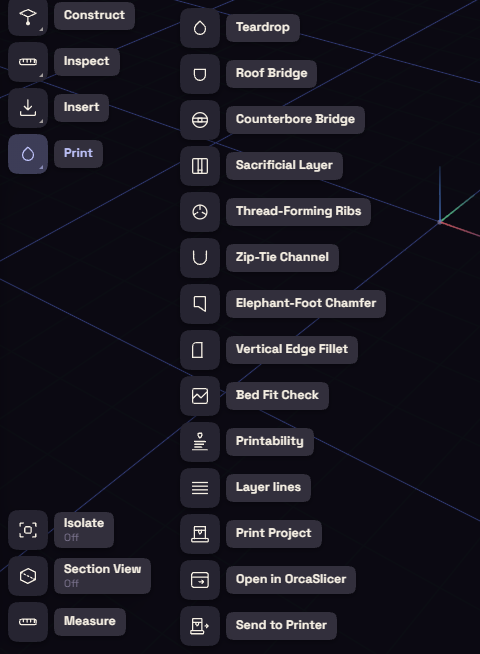

# Printer connection

This plugin takes a model from FundaCAD to OrcaSlicer and to a Moonraker printer on your local network. It is on by default and works in the desktop app only.

Its commands are under Print on the rail and in the File menu.

| Command | What it does |
| --- | --- |
| Print Project | Saves a 3MF with one object per body and its filament slot. In the File menu it is Export for Print (3MF)… |
| Open in OrcaSlicer | Saves the same 3MF and opens it in OrcaSlicer |
| Send to Printer | Sends a sliced `.gcode` file to the printer and starts it |
| Camera… | Shows the printer's camera, from the File menu |

## Send a job

1. Slice the model in OrcaSlicer and save the `.gcode`.
2. Choose Send to Printer and pick that file.
3. Choose the toolhead that holds each filament.
4. Tick Auto bed leveling, Flow calibrate or Timelapse if you want them.
5. Press Upload & Print.

While the job runs, a pill near the bottom of the window shows its progress. Click the pill to see the camera.

## Your printers

The printer list is `printers.json`, in the app data folder under `plugin-data/FundaCAD.Printing`. The plugin only reaches addresses on your local network.
