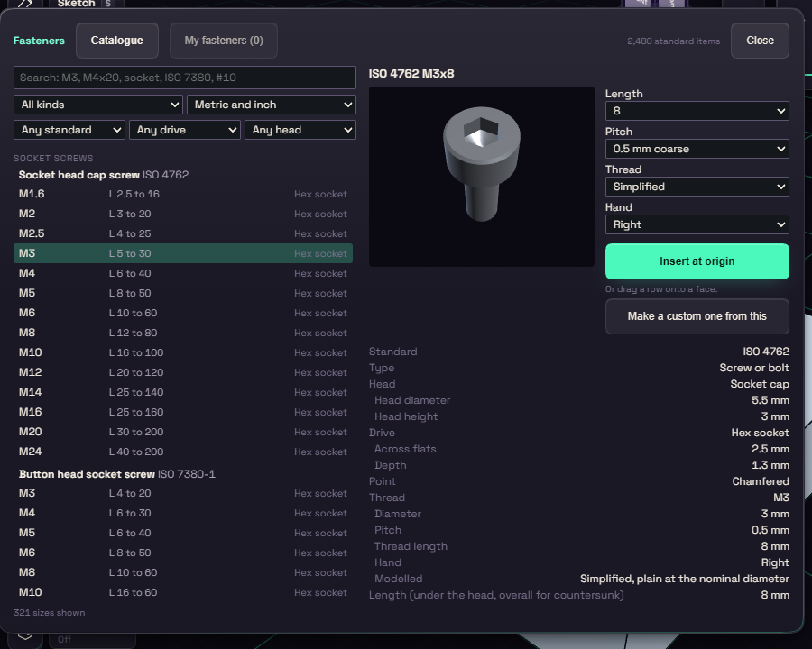

# Fasteners

This plugin is a library of standard screws, nuts, washers and heat-set inserts. It is on by default, under Insert on the rail.

Search the Catalogue, for example `M4x20` or `socket`, and click a row to see a preview and a table with the clearance hole and tap drill size. You can change the length, the drive and the pitch.

Thread set to Simplified is a plain cylinder that builds fast, and Modelled helix builds a real thread for close-ups.

Select one flat face and press Insert on selected face to place it there. It becomes an ordinary body stored in your document. New fastener on the My fasteners tab makes your own.
