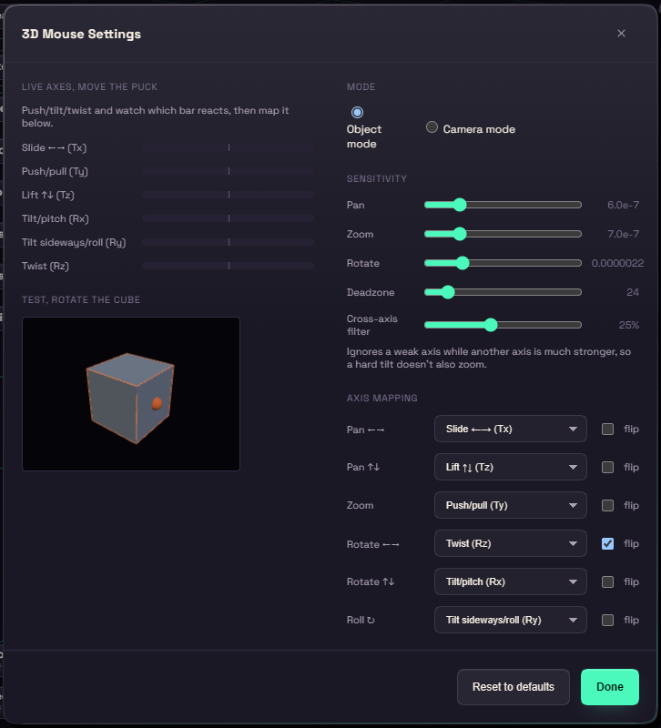

# 3D mouse

If you have a 3D mouse, this plugin lets you fly around the model with its puck. It is on by default and adds a View menu.

Object Mode turns the view the way you would turn a part held in your hand, and Camera Mode flies the camera around it. Both only change the view, never the model. Switch in the View menu. Button 1 fits the view and button 2 returns to the isometric view.

View, 3D Mouse Settings sets the sensitivity and the Deadzone, which helps if the view creeps. If FundaCAD finds the mouse but cannot read it, it needs permission to read the device.
