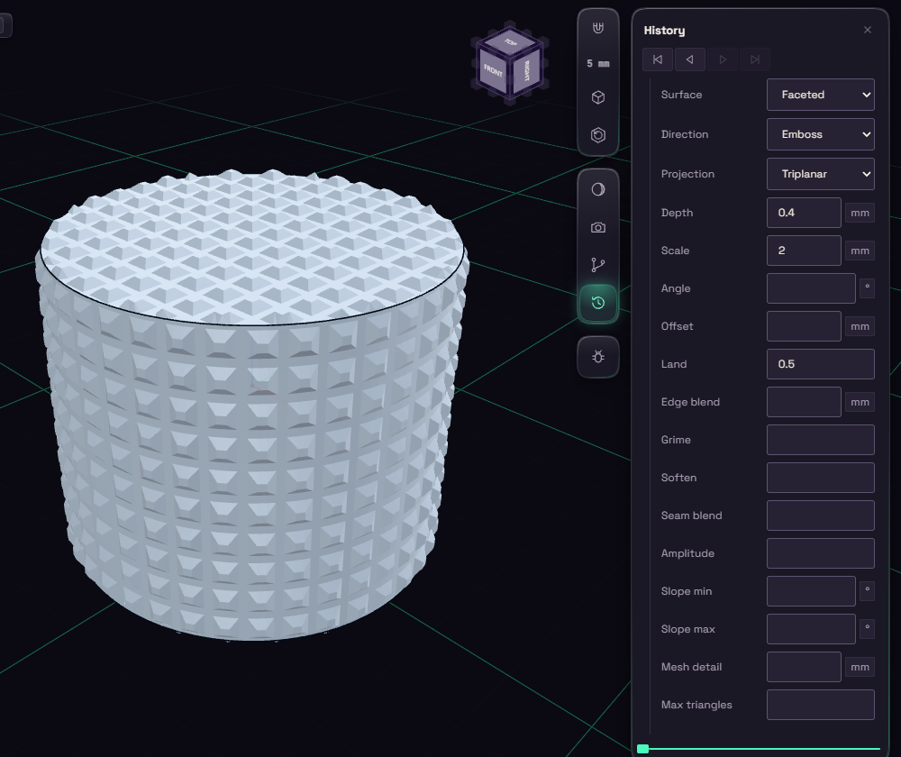

# Surface Texture

Surface Texture puts a pattern on a face or body as real shape, so your slicer receives what you see. It is on by default, under Modify on the rail.

Select the face around a knob and pick Texture. Choose Faces or Whole Body, open Kind and pick Knurl, set a small Depth, and press Add. Double-click the step later to reopen it, or delete it to get the smooth surface back.

Kind offers patterns such as Hex, Waves, Ribs, Voronoi and Leather, and Heightmap turns a picture into height. Depth and Scale set the size. A heavy texture can slow the model, and Mesh mm under Advanced makes it coarser.
