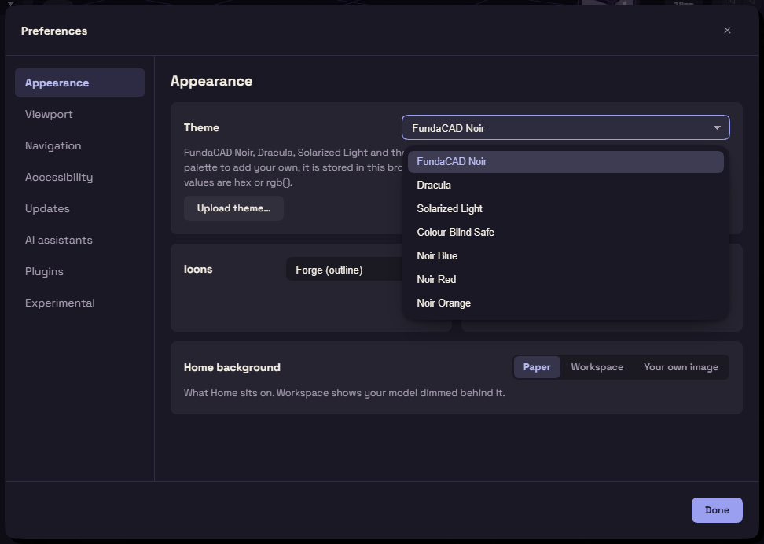

# Preferences

Preferences holds the settings that belong to you, not to a document. Open it from Edit, Preferences…, or press Ctrl+,. Most changes apply at once.



## Pages

| Page | What it sets |
| --- | --- |
| Appearance | Language, Theme, Icons, Units, Home background |
| Viewport | Reflections, Background, Environment brightness, Tangent edges, Bloom, Path tracer, Performance mode, Potato mode |
| Navigation | Smoothing, Orbit pivot, Orbit inertia, Scrolling, Two-finger scroll, Classic camera |
| Accessibility | Contrast, Solid panels, Interface size, Comfortable text, Viewport labels, Announcements, Units spoken in full, Hover delay, Notification time, Single key shortcuts, Larger click targets, Animations. See [Accessibility](accessibility.md) |
| Updates | Check for updates automatically, how often, and Channel |
| AI assistants | See [Connect an AI assistant](../ai/connect.md) |
| Plugins | See [Plugins](../plugins/index.md) |
| Experimental | The limits FundaCAD keeps for stability |

## Language

Language sets the language of FundaCAD's text, and it applies at once. System, the default, is English for now. Deutsch, Français, Español, 简体中文 and 日本語 are machine translated, and the list says so in each language's own words. A machine translated line may read oddly. So far the Language card, the Stress setup step, the menu bar, the command palette and the tool rail speak them, the rest stays English until it is translated. The command palette also finds a command or a tool by its English name, so `save as` still finds Save As and `extrude` still finds the extrude tool in Deutsch.

Numbers follow the language, in the boxes and when you type them. In Deutsch, Français and Español a box shows a comma, `12,375`, and a comma is the decimal mark, so `1,5` and `1,500` mean 1.5, and a point works too, so `0.250` means 0.25, except a point before exactly three digits after a whole number of 1 or more, such as `1.500`, which is refused because it could be a thousand, so write `1,5` or `1500`. In English, 简体中文 and 日本語 `1,5` still means 1.5, and `1,500` is refused because it could be a thousand, so write `1.5` or `1500`. A pair of numbers in one box, and a list of choices such as `Small = 2,5; Large = 30`, takes a semicolon in a language with a decimal comma. Your own language file follows its code, so `pl.json` gives a comma and `de-CH.json` a point. Saved files always keep the point.

Your own language file corrects any line. Its name is the language code: `de.json` corrects single German lines, and `pl.json` adds Polish to the list as polski (your file), with its missing lines in English. A regional file such as `de-AT.json` takes its missing lines from German. Whenever a file of yours is in use, the list says (your file) beside its language, and beside System when System is that language. The file is a flat JSON list of lines like FundaCAD's own language files, saved as UTF-8 text, at most 256 KB. A line that is empty, holds markup, or that FundaCAD does not have, is skipped, and the card lists the skipped lines with the reason. The lines that tell you about your file, such as how many of its lines are in use, stay as FundaCAD wrote them.

Each line is the line's name, then its text. Copy the names from FundaCAD's English file, [en.json](https://github.com/Paraxdev/fundacad/blob/main/src/i18n/locales/en.json), which holds every line, and keep the names in braces such as `{name}` as they are, FundaCAD puts a value there. This `de.json` changes two German lines:

```json
{
  "prefs.language.title": "Sprache der Oberfläche",
  "prefs.language.reload": "Neu einlesen"
}
```

Notes for translators on Windows. Save the file as UTF-8, in Notepad choose Save as and set Encoding to UTF-8, or accented letters will not read back. Turn on File name extensions in the Explorer View menu (Show, File name extensions), so you can see that the file is `pl.json` and not `pl.json.txt`, which Notepad adds when it is allowed to. A file named `pl.json.txt` in the languages folder is not listed, rename it to `pl.json`. A file that is not valid JSON is refused with the line and column where it breaks, for example near line 4, column 18, and a comma after the last line is the usual cause.

A count has one text for each plural form, and each language has its own forms. English has `one` and `other`, Polish has `one`, `few`, `many` and `other`, so a Polish file writes all four. With only `one` and `other` it would show "2 ścian" where Polish says "2 ściany":

```json
{
  "stress.faces.count": "{n, plural, one {# ściana} few {# ściany} many {# ścian} other {# ściany}}"
}
```

Only the text inside the inner braces is yours to translate. The rest is code and stays in English: the words `plural` and `select`, the forms `one`, `few`, `many` and `other`, the option words of a choice such as `up` in `{direction, select, up {, up (+Z)} other {}}`, and the names in braces such as `{n}`. `#` is the number. [docs/I18N.md](https://github.com/Paraxdev/fundacad/blob/main/docs/I18N.md#messages) lists every form.

In the desktop app, Open folder opens your languages folder, and makes it the first time. FundaCAD reads the files there when it starts and when you press Reload, so press Reload after you add or change one. A link in place of a file is not read. In safe mode the folder is not read and both buttons are off.

Outside the desktop app, Load file… takes your own language file and switches to its language. The browser keeps the file until Remove your lines or a Reset settings drops it.

Saved documents never hold translated text, so they open the same in every language.

## Themes

Theme colours the whole app. These ship with FundaCAD:

1. FundaCAD Noir, the default, and its tints Noir Blue, Noir Red and Noir Orange
2. Dracula
3. Solarized Light
4. Colour-Blind Safe, its colours stay apart for every common kind of colour blindness, and its Y axis is yellow

Upload theme… adds your own from a JSON file of colour tokens, such as `--bg` and `--accent`, with values in hex or rgb(). Remove asks first, then takes it away again.

## Size and text

Interface size, under Accessibility, makes every panel, menu and label larger or smaller, from 80 to 200 percent. Ctrl+Plus, Ctrl+Minus and Ctrl+0 step it up, down and back to 100 percent from anywhere, even while you type in a box, and the command palette has Larger Interface, Smaller Interface and Reset Interface Size. FundaCAD keeps the size when you restart it, and Reset to defaults puts it back to 100 percent. Reset to defaults asks first, because it clears every Accessibility choice, Hover delay too.

At a large size, or in a small window, the tool rail and the view controls on the right scroll when they no longer fit. An arrow at the top or bottom of the rail pages through the tools out of sight, and Tab scrolls each one into view as it reaches it. When the window gets too narrow for the title bar, the document name and the Model and Render switch move to the top of the File menu.

Comfortable text spaces lines, letters and words further apart, which some people with low vision or dyslexia read more easily. Buttons and labels grow to fit the wider text.

Viewport labels sizes what is drawn over the model: sketch dimensions, constraint marks, plane names and the view cube. Pick Small, Medium, Large or Extra large, Medium is the default.

## Speech

Announcements, under Accessibility, sets how much FundaCAD tells a screen reader: Off for nothing, Errors for errors only, Normal for prompts and results, or Verbose for every change as well. Normal is the default.

Units spoken in full makes a field tell a screen reader its unit as a word, so a length reads as millimetres and an angle as degrees. Turn it off to hear the short form, mm and deg. It is on by default, and Reset to defaults turns it back on.

## Good to know

1. Units changes the display only, geometry is always stored in millimetres.
2. Tangent edges sets how the line along a smooth fillet shows: Show, Faint or Hide.
3. Path tracer picks where Path traced runs: Auto, Native or WebGPU. High quality denoise downloads a better denoiser for Native.
4. Performance mode and Potato mode lighten the view on a slow computer. Potato mode includes Performance mode.
5. Orbit pivot is what a drag turns the view about: Under cursor, Origin or Selection.
6. Classic camera brings back the earlier camera, after a restart.
7. Animations off makes every move instant. It follows the system's reduce motion setting until you change it.
8. Hover delay is how long the pointer rests on a part before one face lights up instead of the whole part.
9. Notification time is how long messages stay: Normal, Longer, or Until dismissed. Pointing at a message or moving focus into it holds it, and a message with a button stays at least 15 seconds. Until dismissed keeps each one until you close it, and an error in the title bar gets a Dismiss button.
10. Updates checks Daily unless you pick Every launch or Weekly. Turned off, nothing is sent until you use Help, Check for Updates….
11. Channel picks Stable or Beta for the next check. Development opens the page of FundaCAD Dev, a separate app that installs beside this one.

## Experimental

Experimental raises the limits FundaCAD keeps for stability: the HDR environment size, and the samples, bounces, firefly clamp, trace resolution, picture size and triangle count of Path traced.

These can make FundaCAD unstable or crash it. Reset to defaults asks first, then puts every one back.
