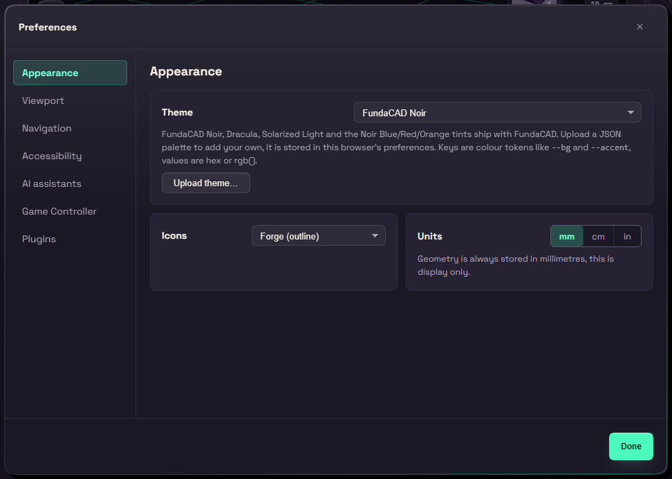

# Preferences

Preferences holds the settings that belong to you and not to a document. Open it from Edit, Preferences, or press Ctrl+,. Changes apply at once.

Appearance sets the Theme, the icons and the Units. Units change the display only, because geometry is always stored in millimetres.

Viewport sets Reflections, Background and Brightness. Tangent edges decides whether the line across a smooth fillet is shown. Performance mode and Potato mode lighten the view on a slow machine.

Navigation sets Smoothing, Orbit inertia and Scrolling for a mouse or touchpad. Accessibility holds Animations and Hover delay.

