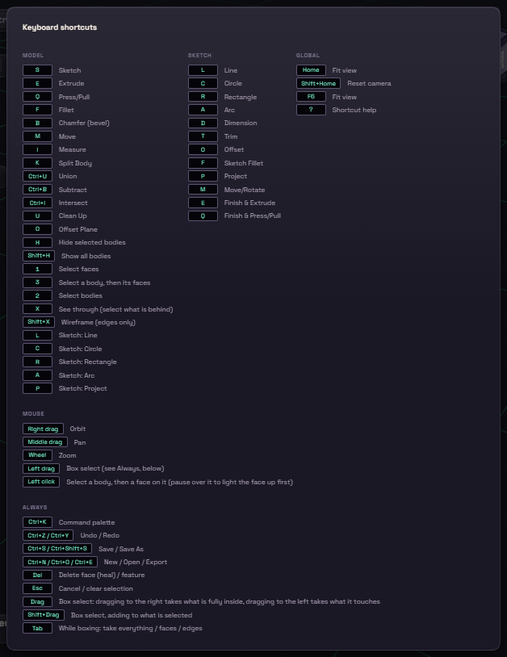
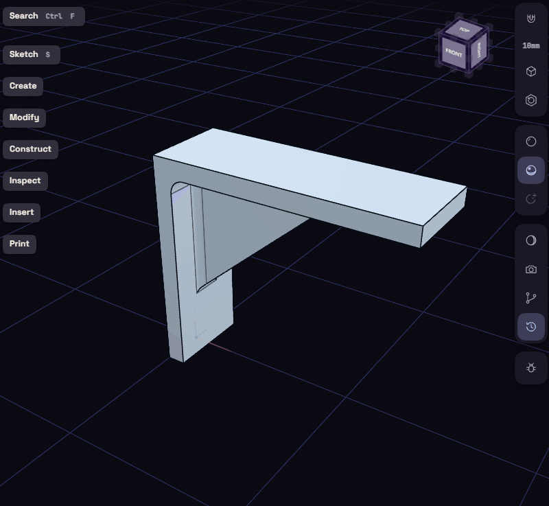

# Shortcuts

Press ? in the app to see the same list. On a Mac, use Cmd for Ctrl. Single letters are ignored while you type in a box.

| Key | In the model |
| --- | --- |
| S | Sketch |
| E | Extrude |
| Q | Press/Pull |
| F | Fillet |
| B | Chamfer |
| M | Move |
| I | Measure |
| K | Split Body |
| O | Offset Plane |
| Ctrl+U, Ctrl+B, Ctrl+I | Union, Subtract, Intersect |
| H, Shift+H | Hide selected, show all |
| 1, 2, 3 | Pick faces, bodies, or body then faces |
| X, Shift+X | See through, wireframe |

| Key | In a sketch |
| --- | --- |
| L, R, C, A | Line, Rectangle, Circle, Arc |
| D | Dimension |
| T | Trim |
| O | Offset |
| F | Sketch Fillet |
| P | Project |
| M | Move/Rotate |
| E, Q | Finish and start Extrude or Press/Pull |

| Key | Anywhere |
| --- | --- |
| Ctrl+K | Command palette |
| Ctrl+Z, Ctrl+Y | Undo, Redo |
| Ctrl+Shift+S | Save As |
| Ctrl+E | Export |
| Ctrl+, | Preferences |
| Home | Fit the view |
| Esc | Cancel the tool or clear the selection |

| Mouse | What it does |
| --- | --- |
| Right-drag | Orbit |
| Middle-drag, Shift+right-drag | Pan |
| Wheel | Zoom |
