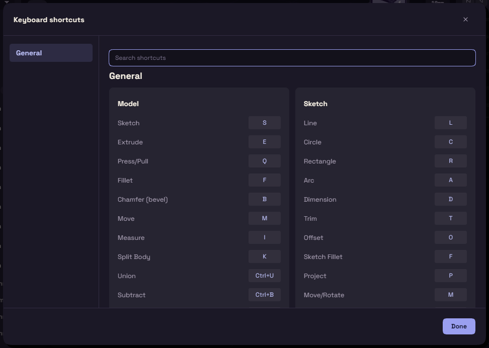
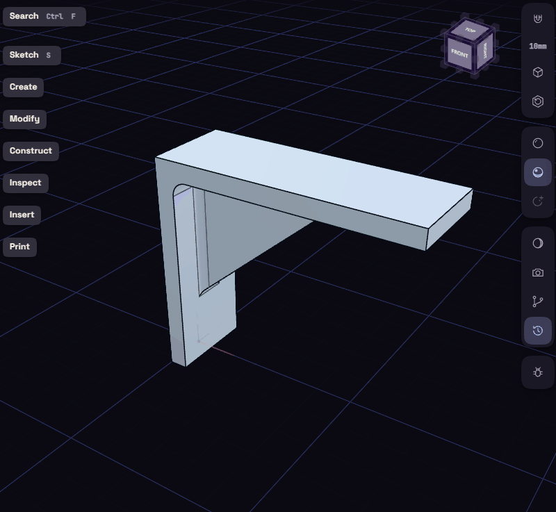

# Shortcuts

Press ? or use Help, Keyboard Shortcuts to see every key. On a Mac, use Cmd for Ctrl. Single letters are ignored while you type in a box.

## Change a key

1. Press ? to open Keyboard shortcuts.
2. Click the key next to a command. Search shortcuts finds it by name.
3. Press the new keys, or Esc to cancel.
4. If another command has those keys, pick Replace or Cancel.

Reset puts one key back, Reset all a whole page. A key marked fixed cannot be changed. A plugin with its own keys gets its own page.

## Keys

| Key | In the model |
| --- | --- |
| S | Sketch |
| E | Extrude |
| Q | Press/Pull |
| F | Fillet |
| B | Chamfer |
| M | Move |
| I | Measure |
| K | Split Body |
| U | Clean Up |
| O | Offset Plane |
| Ctrl+U, Ctrl+B, Ctrl+I | Union, Subtract, Intersect |
| L, R, C, A, P | Start a sketch with Line, Rectangle, Circle, Arc or Project |
| H, Shift+H | Hide selected bodies, show all bodies |
| 1, 2, 3 | Select faces, bodies, or a body then its faces |
| X, Shift+X | See through, wireframe |

| Key | In a sketch |
| --- | --- |
| L, R, C, A | Line, Rectangle, Circle, Arc |
| D | Dimension |
| T | Trim |
| O | Offset |
| F | Sketch Fillet |
| P | Project |
| M | Move/Rotate |
| E, Q | Finish and start Extrude or Press/Pull |
| H, V | Horizontal, Vertical |
| I | Coincident or on curve |
| G, N | Tangent, Perpendicular |
| Shift+P, Shift+E, Shift+L | Parallel, Equal, Collinear |
| Shift+C, Shift+M, Shift+S | Concentric, Midpoint, Symmetric |
| Shift+F | Fix |

| Key | On the focused 3D view, see [Pick with keys](../model/picking.md#pick-with-keys) |
| --- | --- |
| `]`, `[` | Step to the next or previous face, edge or plane, with a light |
| Shift+`]`, Shift+`[` | Switch what the brackets step through: Faces, Edges or Planes |
| Enter | Select the lit row only, or start a sketch on a lit plane |
| Space | Add or remove the lit row |
| Esc | Put the light out and clear the selection |

| Key | Anywhere |
| --- | --- |
| Ctrl+K or Ctrl+F | Command palette |
| Ctrl+Z, Ctrl+Y | Undo, Redo |
| Ctrl+S, Ctrl+Shift+S | Save, Save As |
| Ctrl+N, Ctrl+O, Ctrl+E | New, Open, Export |
| Ctrl+, | Preferences |
| Ctrl+Plus, Ctrl+Minus, Ctrl+0 | Interface size larger, smaller, back to 100 percent |
| Ctrl+Alt+S, Ctrl+Alt+H | Show or hide the items and the history |
| Home, Shift+Home | Fit view, reset camera |
| F6, Shift+F6 | Next and previous region, such as the tools, Items and the 3D view |
| Arrow keys | Turn or tilt the view 15°, 5° with Shift |
| Z, Shift+Z | Next and previous view mode |
| Shift+V | Clean view, hides every overlay until pressed again |
| Del | Delete the selected face or feature |
| Esc | Cancel the tool or clear the selection |
| Tab | While box selecting, choose what the box takes |

Next Face, Previous Face, Next Edge, Previous Edge and Browse Faces and Edges have no key until you give them one. They are in the Edit menu and the command palette. The keys inside the Geometry list are on [the Items card](../model/items.md#keys-in-the-list).

## Mouse

| Mouse | What it does |
| --- | --- |
| Right drag | Orbit |
| Middle drag, Shift+right drag | Pan |
| Wheel | Zoom |
| Ctrl+wheel | Pan up and down (a touchpad pinch still zooms, but pans too with Scrolling set to Mouse in Preferences) |
| Right click | Context menu |
| Left click | Select a body, then a face on it |
| Left drag to the right | Box select what is fully inside |
| Left drag to the left | Box select what the box touches |
| Shift+left drag | Box select, adding to the selection |

The Mouse and keys plugin can move orbit and pan to other buttons, see [Plugins](../plugins/index.md).
